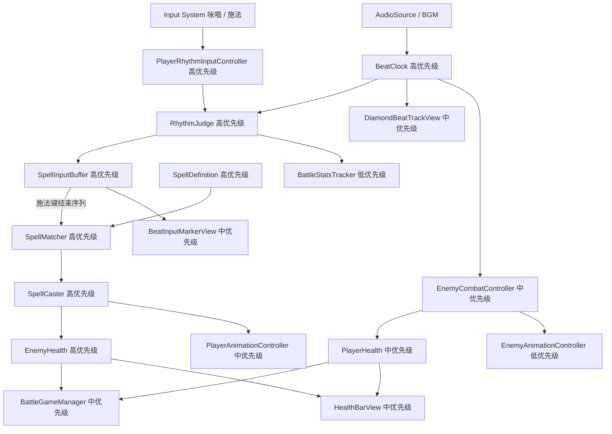
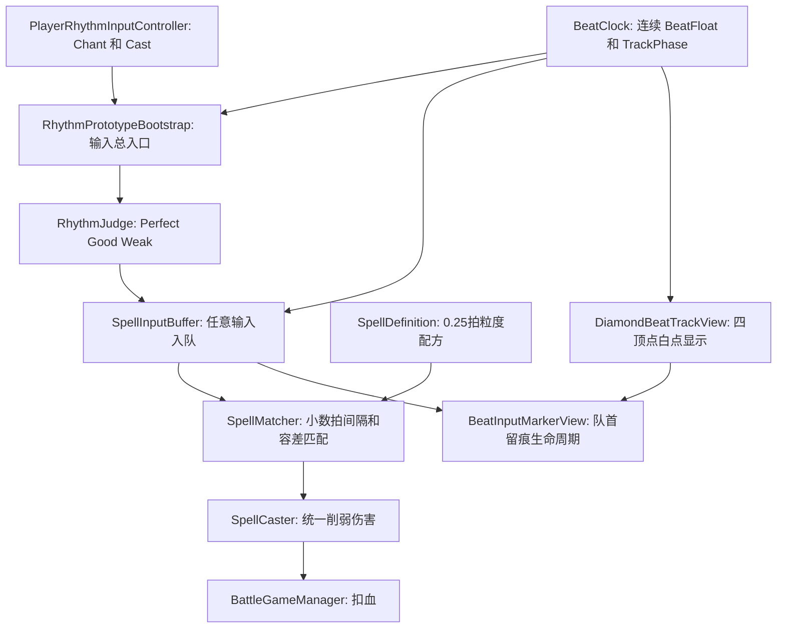

# BeatSpell 音乐节奏原型计划

## 已确认玩法规则

- 玩家在战斗房间中根据局内 BGM 的 BPM 输入节拍。
- 输入分为两个动作：`咏唱` 和 `施法`，两者都记录到全局 BPM 时间轴。
- 每次输入都基于全局 BPM 时间轴得到准确度反馈：`Perfect`、`Good` 或 `Weak`。
- 旧规则“`Miss` 立刻打断当前咏唱”废弃；节拍偏移不再直接打断输入序列，只影响 UI 反馈与伤害倍率。
- 玩家先进行若干次咏唱，最后通过施法键结束序列并尝试释放魔法。
- 魔法识别使用“输入类型序列 + 小数拍间隔 + 容差”，支持 `0.5` 拍、`0.25` 拍等非整数拍配方。
- 魔法是否释放成功由 `SpellMatcher` 判断：类型和数量一致，并且相邻输入间隔与配方间隔差值不超过 `matchToleranceBeats`。
- 菱形音轨只是 UI 可视化辅助：当前节拍白点仍只在四个顶点依次显示；输入判定和生命周期判断不依赖 UI 本身。
- 留痕是队列模型：队首输入点作为生命周期参考，底层当前节拍相位绕一圈回到队首相位时，清空输入缓存和音轨留痕。
- 咏唱本身没有失败概念；如果一圈生命周期内没有主动 `Cast`，队尾触发“虚拟 Cast 失败”反馈，用于播放施法失败动画和音效。
- 连续咏唱跨圈时，虚拟 Cast 失败反馈可以先触发一瞬间；后续 `Chant` 会在动画层取消失败动作并成为下一圈队首，失败音效应独立播放完。
- 施法失败残留需要统一清理：无咏唱直接施法、配方不匹配、虚拟 Cast 失败后，下一次 `Cast` 应先清旧 Buffer 和旧 UI，再显示当前这次施法失败反馈，避免多个黑色施法 Marker 同屏。
- 敌人也跟随 BPM 行动，例如提前若干拍播放攻击预警，在指定节拍点执行攻击。

## 推荐核心判定模型

- 使用 `AudioSettings.dspTime` 作为节拍时钟基础，避免普通 `Time.time` 带来的音频同步误差。
- 根据 `BPM` 计算每拍长度：`secondsPerBeat = 60f / bpm`。
- 玩家按键时，记录连续 `BeatFloat` 与 `TrackPhase`，并计算输入时间距离最近理论节拍点的偏差。
- 判定窗口建议初始值：
  - `Perfect`：约 ±50ms
  - `Good`：约 ±120ms
  - `Weak`：超过 Good 窗口，但仍可进入咏唱/施法队列
- 魔法匹配示例：
  - 火焰魔法（Demo）：`咏唱 -> 1拍 -> 施法`
  - 半拍测试魔法：`咏唱 -> 0.5拍 -> 咏唱 -> 0.5拍 -> 施法`
  - 1/4 拍测试魔法：`咏唱 -> 0.25拍 -> 施法`
- 伤害结算建议：全部 Perfect 为 100%；只要包含非 Perfect 但配方匹配成功，先统一为 80%；后续再按偏移量做连续伤害曲线。

## 原型架构图

## 优先级说明

- 高优先级：决定玩法是否成立，先实现并用 Console 或简单文本验证，不依赖最终美术和复杂 UI。
- 中优先级：决定游戏是否像截图中的目标体验，包括菱形音轨、血量、敌人节拍攻击和动画触发。
- 低优先级：锦上添花或统计性质内容，包括完整动画包装、战斗统计、暂停界面和 Buff 系统。
- 开发时不要先追求完整视觉效果；先证明“听 BPM 输入 -> 判定 -> 匹配魔法 -> 造成伤害”这条链路稳定。

## 系统拆分建议

- 节拍系统
  - `BeatClock`：维护 BPM、当前拍号、当前四顶点索引、输入偏差计算。
- `RhythmJudge`：根据偏差输出 `Perfect / Good / Weak`，只表示准确度，不负责打断输入。
  - `PlayerRhythmInputController`：接收咏唱/施法输入，不在 `Update` 中反复 `GetComponent`。
- 魔法系统
  - `SpellDefinition`：用 ScriptableObject 配置魔法名、等级、基础伤害、输入步骤和间隔。
  - `SpellInputBuffer`：记录当前咏唱到施法期间的输入序列。
  - `SpellMatcher`：在施法时匹配魔法定义。
  - `SpellCaster`：执行伤害、动画和反馈。
- 玩家系统
  - `PlayerCombatController`：整合输入、咏唱状态、施法结果。
  - `PlayerHealth`：管理玩家生命值。
- `PlayerAnimationController`：播放待机、咏唱、施法、弱命中反馈动画。
- 敌人系统
  - `EnemyCombatController`：根据拍号调度攻击预警和攻击瞬间。
  - `EnemyHealth`：管理敌人生命值和死亡。
  - `EnemyAnimationController`：播放待机、预警、攻击、受击动画。
- UI 系统
  - `DiamondBeatTrackView`：显示四边、四顶点、中点，以及当前完美节拍点。
  - `BeatInputMarkerView`：显示玩家输入留下的黄色咏唱点、黑色施法点。
  - `HealthBarView`：玩家和敌人血量显示。
  - `HintTextView`：显示操作提示和判定结果。
- 全局系统
  - `BattleGameManager`：控制战斗开始、胜利、失败、暂停。
- `BattleStatsTracker`：记录通关时间、Perfect 次数、Good 次数、Weak 次数和魔法匹配失败次数。
  - Buff 系统先预留接口，Demo 初期不作为第一优先级。

## 实现顺序

1. 先完成节拍时钟和输入准确度，让没有 UI 的情况下也能在 Console 中输出 `Perfect / Good / Weak`。
2. 再实现输入序列缓存和魔法匹配，能用咏唱/施法按键释放 1 到 2 个测试魔法。
3. 接着接入玩家和敌人血量，完成“按节拍施法造成伤害，击败敌人”的闭环。
4. 然后制作菱形音轨 UI，让当前节拍点和玩家输入点可视化。
5. 最后接入敌人 BPM 攻击、动画占位、暂停和战斗统计。

## 计划使用指南：小步迭代 vibeCoding

- 每一轮只选一个高优先级目标，不要同时要求节拍、魔法、UI、敌人全都完成。
- 每轮开始时，用一句话描述本轮目标，例如：`本轮只实现 BeatClock 和 RhythmJudge，按键时在 Console 输出 Perfect / Good / Weak`。
- 每轮都要求一个可验证结果，例如 Console 日志、Inspector 可调参数、场景中可见的 UI 变化或敌人扣血。
- 每轮完成后先试玩，再根据手感调整窗口参数，例如 `BPM`、`PerfectWindowMs`、`GoodWindowMs`，不要急着扩展新系统。
- 遇到体验不准时，优先检查节拍时间轴和输入判定，再检查 UI 表现；因为音轨 UI 只是辅助显示，不应该反过来驱动判定。
- 使用 UnityMCP 时，适合让它做场景搭建、对象挂载、截图检查和 Console 日志读取；核心 C# 逻辑仍按本计划分模块实现。
- 推荐迭代节奏：
  1. 第 1 轮：只做节拍时钟和输入判定。
  2. 第 2 轮：加入输入缓存和一个测试魔法。
  3. 第 3 轮：加入敌人血量和伤害结算。
  4. 第 4 轮：加入菱形音轨可视化。
  5. 第 5 轮：加入敌人按节拍攻击。
  6. 第 6 轮：补动画、统计、暂停和 Buff 预留。
- 每轮结束都更新这份计划：把已完成项标记出来，把新发现的问题写到对应系统下面，避免需求散落在聊天里。

## 第 4 轮魔法系统完整补完计划

### 本轮目标

本轮先不进入第 5 轮敌人节拍攻击，而是完整补齐第 4 轮遗留的魔法输入模型：

- 魔法配方支持 `0.5` 拍、`0.25` 拍等非整数间隔。
- 玩家任意时刻都能咏唱/施法，输入不再因为 `Miss` 被打断；节拍准确度只影响伤害和 UI 反馈。
- 魔法释放仍有配方匹配边界：输入类型、数量、相邻间隔必须在最大误差阈值内，超出阈值则匹配失败。
- 留痕改为队列模型：队首输入点作为生命周期参考，底层当前节拍相位绕一圈后与队首相位相交时清空缓存和 UI。
- 当前节拍白点 UI 继续保持现有模式：只在 Top / Right / Bottom / Left 四个顶点跳动，不新增沿边连续移动的白色游标。
- 后续补完目标：队首一圈结束但未主动施法时触发虚拟 Cast 失败；连续咏唱可在失败动画启动后立刻取消该动画并开启下一圈，音效继续播完；连续施法失败时旧失败 UI 和数据必须被新失败替换。

### 接入架构

### 小步 1：节拍时间模型支持小数拍

修改 `Assets/Scripts/Rhythm/BeatClock.cs` 和 `Assets/Scripts/Rhythm/BeatTimingGrade.cs`：

- 给 `BeatTimingInfo` 增加连续字段：`BeatFloat`、`TrackPhase`。
- `BeatFloat = (dspNow - songStartDspTime) / secondsPerBeat`，`TrackPhase = BeatFloat % 4`。
- 保留 `BeatIndex` / `VertexIndex` 给现有四顶点白点 UI 和日志兼容，但后续匹配不再依赖整数 `BeatIndex`。
- 把 `Miss` 语义替换为 `Weak` 或等价弱命中档位；如果为了减少一次性破坏可先保留枚举名，但不得再用于打断咏唱。

### 小步 2：输入准确度不再打断

修改 `Assets/Scripts/Rhythm/RhythmJudge.cs`、`Assets/Scripts/Spell/SpellInputBuffer.cs`、`Assets/Scripts/Debug/RhythmPrototypeBootstrap.cs`：

- `RhythmJudge` 只输出准确度：`Perfect / Good / Weak`。
- `SpellInputBuffer.TryAppend` 删除 `grade == Miss` 时 `Clear()` 和 `ChantBroken` 的路径。
- 任意咏唱/施法都能入队，除非仍处于“空施法半拍封锁”这种结构性惩罚。
- 空施法惩罚保留：无咏唱 Cast 不入缓冲，但须在音轨留**黑色施法痕**；该黑痕是短效反馈 Marker，自销毁时间等于本次输入无效时间（`EmptyCastPenaltySeconds`，约半拍），约半拍内仍 `InputRejected`（见 `Assets/Docs/第4轮魔法完整补完plan.md` 小步 2 补丁）。

### 小步 3：魔法配方支持半拍和 1/4 拍

修改 `Assets/Scripts/Spell/SpellDefinition.cs`、`Assets/Scripts/Spell/RhythmInputEntry.cs`、`Assets/Scripts/Spell/SpellMatcher.cs`：

- `RhythmInputEntry` 增加 `BeatFloat`，把 `IntervalBeatsFromPrevious` 从 `int` 改为 `float`。
- `SpellDefinition` 的 `intervalsBetweenSteps` 从 `int[]` 改为 `float[]`，Inspector 中可填 `1`、`0.5`、`0.25`。
- 增加 `matchToleranceBeats`，建议默认 `0.125` 拍，也就是 1/8 拍容差。
- `SpellMatcher` 用 `abs(actualInterval - expectedInterval) <= tolerance` 判断，而不是整数相等。
- 新增测试配方：`Fireball_Lv1`、`HalfBeat_Test`、`QuarterBeat_Test`。

### 小步 4：统一削弱伤害，不再因 Weak 归零

修改 `Assets/Scripts/Spell/SpellMatcher.cs` 和 `Assets/Scripts/Spell/SpellCaster.cs`：

- 匹配成功后，如果全部输入都是 `Perfect`，`damageFactor = 1.0`。
- 只要有任意非 Perfect 输入，先统一 `damageFactor = 0.8`。
- 不再出现 `Weak/Miss -> damageFactor=0` 的逻辑。
- Console 日志建议输出：`[Spell] Matched Fireball | accuracy=Mixed | damageFactor=0.8`。

### 小步 5：重做留痕生命周期和视觉等级

修改 `Assets/Scripts/UI/DiamondBeatTrackView.cs` 和 `Assets/Scripts/UI/BeatInputMarkerView.cs`：

- `DiamondBeatTrackView` 保留现有当前节拍点 UI：白点只在 Top / Right / Bottom / Left 四个顶点跳动，不新增沿边连续移动的白色游标。
- `BeatClock.TrackPhase` 仍保留为规则层数据，用于判断“底层当前节拍位置”是否绕回队首输入相位；它不直接改变当前白点 UI 的显示模式。
- `BeatInputMarkerView` 不再用固定秒数简单清理，而是记录队首 `BeatFloat` / `TrackPhase`。
- 当当前 `BeatFloat >= headBeatFloat + 4`，说明底层节拍相位绕一圈回到队首输入点，清空输入缓存和 Marker。
- Marker 样式按准确度区分：`Perfect` 显示黄色底 + 放射线段；`Good/Weak` 显示黄色底但不显示放射线段。
- 队首清理必须由核心节拍数据判断，不能由 UI 碰撞或图片位置反推。

### 后续补完：施法失败与连续输入换圈

修改 `Assets/Scripts/Debug/RhythmPrototypeBootstrap.cs`、`Assets/Scripts/Spell/SpellCaster.cs`、`Assets/Scripts/UI/BeatInputMarkerView.cs`：

- 一圈生命周期到点且没有主动 `Cast` 时，触发一次虚拟 Cast 失败事件；这不是 `Chant` 失败。
- 虚拟失败事件负责驱动施法失败动画和音效；动画可被后续 `Chant` 状态取消，音效用一次性播放方式继续播完。
- 下一次 `Chant` 若落在 `head + 4` 附近，清旧轮数据和 UI，把当前 `Chant` 作为下一圈队首。
- 无咏唱 `Cast`、错误配方 `MatchFailed`、虚拟 Cast 失败都进入统一失败残留状态；下一次 `Cast` 先清旧残留，再显示当前 Cast 失败反馈。
- 参数建议：新增 `chantRolloverGraceBeats` 识别跨圈续接；`failedCastCooldownBeats` 控制失败后输入节奏；`failedInputMarkerClearDelayBeats` 控制没有新输入时失败 UI 的自动停留。

### Agent + UnityMCP 验收

- A：`Chant beat=0 offset=0` 入队，准确度 `Perfect`，Marker 有放射线。
- B：`Chant beat=0 offset=200ms` 也入队，不触发 `ChantBroken`，Marker 无放射线。
- C：`Fireball_Lv1`：`Chant beat=0` + `Cast beat=1` 匹配成功，`damageFactor=1.0`。
- D：`Fireball_Lv1`：`Chant beat=0` + `Cast beat=1 offset=80ms` 匹配成功，`damageFactor=0.8`。
- E：`HalfBeat_Test`：`Chant beat=0` + `Chant beat=0.5` + `Cast beat=1.0` 匹配成功。
- F：`QuarterBeat_Test`：`Chant beat=0` + `Cast beat=0.25` 匹配成功。
- G：超出容差：`QuarterBeat_Test` 的 Cast 输入偏离超过 `matchToleranceBeats`，匹配失败但不是因为 `Miss` 打断。
- H：队首生命周期：首个输入在 `beatFloat=0.25`，底层当前节拍推进到 `4.24` 时不清，推进到 `4.25` 或之后清空缓存和 Marker；白点 UI 仍只在四顶点跳动。
- I：无咏唱 Cast → 半拍封锁 + 音轨 1 个短效黑色 Cast 留痕，缓冲为 0；封锁内不再增 Marker；推进到 `EmptyCastPenaltySeconds` 后该短效 Marker 自动销毁，封锁结束后可重新输入。

## Unity 项目落地方式

- 当前项目已安装 `com.unity.inputsystem` 和 `com.unity.ugui`，可直接使用 Input System 绑定咏唱/施法按键，UI 使用 Canvas + UGUI 搭建。
- 由于 `Assets` 下还没有脚本，后续实现会创建少量必要脚本，并尽量按模块放入 `Assets/Scripts/`。
- 使用 UnityMCP 时，优先让它辅助创建场景对象、Canvas、占位 Sprite、测试 AudioSource 和组件挂载；核心判定逻辑仍放在 C# 脚本中，方便调试和扩展。

## 原型成功标准

- 播放 BGM 后，全局节拍稳定推进。
- 玩家按咏唱/施法可获得 `Perfect / Good / Weak` 准确度反馈，任意节拍偏移都不会直接打断输入队列。
- 至少一个整数拍魔法、一个半拍魔法、一个 1/4 拍魔法可以通过配方容差匹配成功释放。
- 匹配成功后，全部 Perfect 为最大伤害；包含非 Perfect 时先统一削弱伤害。
- 菱形音轨能显示四顶点当前节拍点，以及玩家输入留下的咏唱/施法队列留痕；队首相位绕一圈后自动清空。
- 一圈内未主动施法时能触发施法失败反馈；连续咏唱可取消失败动画并进入下一圈，连续施法失败不会叠出多个黑色施法 Marker。
- 敌人能按 BPM 进行预警和攻击。