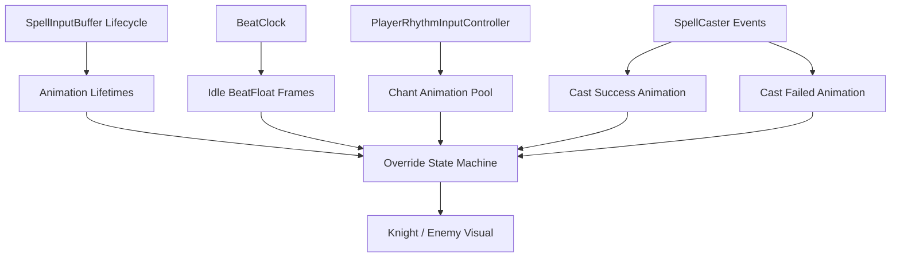

# 玩家角色动画功能落地计划

## 目标边界

本计划只规划角色动画系统如何落地，不立即写代码、不调试场景。

动画表现服务于玩家体验：虽然玩法输入仍叫 `Chant` / `Cast`，但画面上玩家扮演骑士，后续会用挥剑、蓄力、攻击、失败收招等动作承载这些玩法语义。

现有可依赖系统：

- 节拍时钟：[`Assets/Scripts/Rhythm/BeatClock.cs`](Assets/Scripts/Rhythm/BeatClock.cs) 提供 `BeatIndex`、`BeatFloat`、`SecondsPerBeat`。
- 当前拍白点：[`Assets/Scripts/UI/DiamondBeatTrackView.cs`](Assets/Scripts/UI/DiamondBeatTrackView.cs) 在 `VertexIndex` 变化时启动白点 6 帧动画。
- 输入留痕生命周期：[`Assets/Scripts/Spell/SpellInputBuffer.cs`](Assets/Scripts/Spell/SpellInputBuffer.cs) 队首 `BeatFloat + 4` 后过期。
- 失败反馈入口：[`Assets/Scripts/Spell/SpellCaster.cs`](Assets/Scripts/Spell/SpellCaster.cs) 已有 `OnSpellCast`、`OnMatchFailed`、`OnEmptyCastPenalty`、`OnVirtualCastFailed`。
- 当前失败残留规则：[`Assets/Scripts/Debug/RhythmPrototypeBootstrap.cs`](Assets/Scripts/Debug/RhythmPrototypeBootstrap.cs) 中 `failedCastCooldownBeats=0.25`，`failedInputMarkerClearDelayBeats=0.5`，并支持新输入清旧失败残留。
- 美术资源：[`Assets/Art/Character`](Assets/Art/Character) 已按 128×64 网格切片，PPU=100，Bottom Center Pivot。

## 总体设计

新增一个角色动画层，建议命名为 `CharacterBeatAnimationController` 或 `PlayerAnimationController`，只负责视觉表现，不参与节拍判定、配方匹配、伤害结算。

核心原则：

- **唯一节拍源**：动画掐点读取 `BeatClock`，不读取 `DiamondBeatTrackView` 的 UI 状态；角色和白点同步，是因为它们共用同一个时钟。
- **默认 Idle**：没有输入或高优先级动画时，玩家和敌人自动播放 Idle。
- **Idle 与节拍对齐**：`BeatClock.BeatFloat` 在每拍内驱动 N 帧 Idle Sprite，与白点同周期；**无**位移/缩放拍点脉冲。
- **非 Idle 走 Animator**：`Chant` / `CastSuccess` / `CastFailed` 使用 Animator Controller / Clip，由用户在 Unity 中制作具体动作。
- **新输入覆盖旧动画**：新的 Chant / Cast / Failure 可直接取消上一段角色动画，回到最新输入反馈。
- **动画生命周期与玩法生命周期分开但对齐**：动画可以播放一次或维持 pose，清理时机参考现有留痕和失败残留规则。

---

## 优先级 P0：文档与术语约定

目标：先把“玩法叫咏唱/施法，画面是骑士挥剑反馈”写进项目真源，避免后续命名误会。

执行步骤：

1. 在 [`Assets/Docs/项目跟进plan.md`](Assets/Docs/项目跟进plan.md) 增加「角色动画表现约定」。
2. 说明：`Chant` / `Cast` 是玩法层输入，不代表角色一定做魔法手势。
3. 说明：玩家身份是骑士，后续用挥剑、蓄力、攻击动作承载咏唱和施法。
4. 说明：角色动画只订阅节拍/输入/施法结果，不反向驱动判定。
5. 暂不指定具体动画资源对应关系；你后续再描述具体选哪组。

验收标准：

- 文档中明确区分“玩法语义”和“骑士表现”。
- 不修改冻结文档 [`Assets/Docs/第4轮魔法完整补完plan.md`](Assets/Docs/第4轮魔法完整补完plan.md)。

---

## 优先级 P1：待机动画 + 节拍同步帧

目标：开始游戏后，玩家和敌人自动播放 Idle；每 1 拍内按 `BeatClock.BeatFloat` 播完 N 帧，与白点同周期。

设计说明：

- 使用现有 `Idle` 序列作为基础待机（当前 9 格：`Idle_0…Idle_7` + 末帧重复 `Idle_0`）。
- 玩家和敌人都复用 `BeatIdleAnimator`。
- 帧索引由 `beatFraction = BeatFloat - Floor(BeatFloat)` 映射到 `0…N-1`，不使用 `deltaTime` 累加。
- **不**做位移/缩放拍点脉冲。

推荐实现方式：

- Idle 层：`BeatIdleAnimator` 写 `PlayerVisual` / `EnemyVisual` 的 `SpriteRenderer`。
- 时钟未运行时保持第 0 帧，不推进。

执行步骤：

1. 用 `BeatIdleAnimator` 只做 BeatFloat 同步 Idle。
2. 暴露 `BeatClock`、`SpriteRenderer`、Idle Sprite 数组。
3. 玩家和敌人各挂一套相同组件，分别引用自己的 SpriteRenderer。
4. 保持白点 UI 不变，仅共用 `BeatClock`。

验收标准：

- 进入 Play 后不输入，玩家和敌人都播放 Idle。
- `beatFloat=0` → 帧 0；拍内按 N 等分切帧；`beatFloat=1` 回到帧 0。
- 不影响 `[Beat]`、`[Spell]` 日志和输入判定。

---

## 优先级 P2：动画状态机骨架

目标：建立统一状态管理，让后续 Chant / Cast / Failure 都能覆盖当前动画。

状态建议：

- `Idle`：默认状态，由 `BeatIdleAnimator` 按 `BeatFloat` 播完 N 帧。
- `Chant`：咏唱输入反馈状态，Animator state `Chant`（Clip 由用户配置）。
- `CastSuccess`：施法成功状态，Animator state `CastSuccess`。
- `CastFailed`：施法失败状态，Animator state `CastFailed`。

双层所有权：

- `Idle`：启用 `BeatIdleAnimator`，停用动作 `Animator`。
- 非 `Idle`：停用 `BeatIdleAnimator`，启用 `Animator` 并 `Play` 对应 state。
- 具体 Clip 内容、时长、过渡由用户在 Unity 中制作；本轮只提供 Controller 状态名框架。

覆盖规则：

- 新 Chant 覆盖当前 Chant / Idle / CastFailed。
- CastSuccess 覆盖任何非死亡类状态。
- CastFailed 覆盖 Idle / Chant / 上一次失败。
- 若未来有 Hurt / Death，优先级应高于以上所有状态。

执行步骤：

1. 在 `CharacterBeatAnimationController` 内部维护 `currentState`、`stateStartBeatFloat`。
2. 所有外部事件只调用统一入口：`PlayChant()`、`PlayCastSuccess()`、`PlayCastFailed()`、`ReturnToIdle()`。
3. 每次进入新状态先停止上一状态的 Idle 帧或 Animator 播放。
4. 为 MCP 验收暴露只读查询：当前状态、当前帧、当前 Animator state 名、当前状态起始 `BeatFloat`。
5. 非 Idle 关闭 `BeatIdleAnimator`，避免 Idle 帧覆盖 Animator Clip。

验收标准：

- 连续输入时，屏幕上只表现最新一次动作。
- 旧动画不会播放到一半后反过来覆盖新动画。
- 回 Idle 后 `BeatIdleAnimator` 恢复，并立即按当前 `BeatFloat` 同步帧。

---

## 优先级 P3：咏唱动画池

目标：玩家每按一次咏唱键，音轨留痕的同时播放一组大开大合动画；共 5 组动画构成池，相邻两个不能一样。

触发来源：

- 玩家咏唱输入已经通过 `PlayerRhythmInputController.OnRhythmInput` 广播。
- 只响应 `BeatInputType.Chant`。
- `InputRejected` 不应播放 Chant 动画，因为当前输入被封锁且不会留痕。

动画池规则：

- 维护 5 个 `AnimationClip` 或 5 组 Sprite 序列。
- 每次 Chant 从池中选择 1 个。
- 相邻两次 Chant 不能选择同一个；如果随机到相同，重新抽或从排除后的列表抽。
- 是否按 Perfect/Good/Weak 选不同强度，本轮不做；所有合法 Chant 都进同一个池。

需要你审核的生命周期描述：

- **Chant 动画触发时机**：与音轨 Chant 留痕同帧触发，即 `SpellInputBuffer.OnEntryAdded` 或合法 Chant 输入处理之后。
- **Chant 动画播放方式**：每次 Chant 动画先完整播放一遍；如果期间又有新的 Chant / Cast，则立即被新动画覆盖。
- **Chant 动画可见生命周期**：若没有新的输入覆盖，最后一次 Chant 的动画结束后可以停在结尾 pose 或回到 Idle；但它所属的“咏唱表现上下文”应持续到队首生命周期结束，也就是 `headBeatFloat + 4`。
- **与留痕一致的含义**：咏唱队列仍活跃时，角色可以处在“咏唱待机/蓄势”表现；队首留痕被清除时，角色也应退出咏唱上下文回 Idle。
- **匹配成功时**：CastSuccess 立即覆盖 Chant，上一个 Chant 上下文结束；音轨成功留痕仍按现有 UI 规则保留到队首一圈后清空。
- **MatchFailed / 空施法 / 虚拟失败时**：CastFailed 覆盖 Chant，并进入失败生命周期。

执行步骤：

1. 在动画控制器上配置 5 个 Chant 动画槽位。
2. 订阅 `PlayerRhythmInputController.OnRhythmInput`，仅处理合法 Chant。
3. 实现“不连续重复”的随机选择。
4. 记录 `activeChantHeadBeatFloat`，从 `SpellInputBuffer.LifecycleStartBeatFloat` 获取队首。
5. 每帧查询 `BeatClock.BeatFloat`，当达到 `activeChantHeadBeatFloat + 4` 且没有更高优先级动画时回 Idle。
6. 后续可把 Chant 动画与音效 `ChantNormal/ChantPerfect` 同步，但本计划先只管视觉。

验收标准：

- 连续 5 次 Chant，动画池至少能轮换，且相邻两次不相同。
- 第一次 Chant 后 4 拍内没有 Cast，则咏唱表现不会无限残留。
- 到队首一圈结束时，动画上下文与音轨留痕一起结束。
- 新 Chant 可直接覆盖上一段 Chant 动画。

---

## 优先级 P4：施法成功动画

目标：配方匹配成功时播放唯一的施法成功动画。

触发来源：

- `SpellCaster.OnSpellCast`。
- 不直接监听 Cast 输入，因为 Cast 输入可能 MatchFailed 或 EmptyCastPenalty。

生命周期建议：

- CastSuccess 是瞬时结果动画，触发后完整播放一遍。
- 播放期间若有新输入，按“新输入覆盖旧动画”规则处理。
- 如果没有新输入，播放完回到 Idle，并恢复拍点颤抖。
- 成功动画不需要跟随队列留痕保留 4 拍；因为它是“释放成功瞬间”的表现，而不是持续队列状态。

执行步骤：

1. 配置 1 个 CastSuccess 动画槽。
2. 订阅 `SpellCaster.OnSpellCast`。
3. 触发时切到 `CastSuccess` 状态，清理 Chant 上下文。
4. 播放完成后回 Idle。
5. 未来可根据 `damageFactor` 加强表现，但本轮不做分支。

验收标准：

- `Chant 0 + Cast 1` 成功时只播放成功动画，不播放失败动画。
- Good / Weak 混合但匹配成功时仍播放同一个成功动画。
- 成功动画可以被后续输入取消。

---

## 优先级 P5：施法失败动画

目标：所有失败类 Cast 都播放唯一的施法失败动画，并与现有失败留痕/清理规则一致。

触发来源：

- `SpellCaster.OnMatchFailed`：有咏唱但配方不匹配。
- `SpellCaster.OnEmptyCastPenalty`：无咏唱直接 Cast。
- `SpellCaster.OnVirtualCastFailed`：队首一圈结束仍未主动 Cast。

需要你审核的生命周期描述：

- **手动 MatchFailed**：音轨上 Chant + Cast 队列留痕会短暂保留，当前规则约 `failedInputMarkerClearDelayBeats=0.5` 拍后清；失败动画也建议至少覆盖这段时间，避免 UI 还在失败反馈但角色已立刻回 Idle。
- **空施法 EmptyCastPenalty**：音轨只有短效黑 Cast，当前规则失败 UI 约 0.5 拍清除，输入 CD 约 0.25 拍；失败动画建议按 `failedInputMarkerClearDelayBeats` 生命周期，而不是输入 CD，确保反馈可见。
- **虚拟 CastFailed**：队首一圈到期时触发失败动画；如果下一次 Chant 紧接着发生，新 Chant 应立即取消失败动画，作为下一圈队首。失败音效独立播放完，动画可被取消。
- **连续失败 Cast**：下一次 Cast 先清旧失败残留，再显示当前失败反馈；动画同理，新失败直接重播失败动画，不叠加旧失败。

执行步骤：

1. 配置 1 个 CastFailed 动画槽。
2. 订阅 `OnMatchFailed`、`OnEmptyCastPenalty`、`OnVirtualCastFailed`。
3. 触发时进入 `CastFailed` 状态，并记录 `failedStateEndDspTime = now + FailedInputMarkerClearDelaySeconds`。
4. 播放失败动画，如果动画短于失败残留时间，可停在失败 pose 到生命周期结束。
5. 若新 Chant / Cast 到来，立即取消失败动画，执行新输入对应动画。
6. 若失败生命周期结束且没有新输入，回 Idle。

验收标准：

- `Chant 0 + Cast 0.5` 播放失败动画，且不会立即回 Idle。
- 空 Cast 播放失败动画，不进入 Chant 或 CastSuccess。
- `Chant 0` 后到 `+4` 拍触发虚拟失败动画。
- `Chant 0 -> Chant 4.0` 场景中，虚拟失败可以闪一下，但后一个 Chant 立即覆盖它。
- 连续空 Cast 屏幕上只保留最新失败动画。

---

## 优先级 P6：敌人 Idle 同步

目标：敌人在战斗开始后也自动 Idle，并与玩家一样按 `BeatFloat` 同拍切帧。

设计说明：

- 敌人暂不需要 Chant / Cast / Failure 池，只复用 `BeatIdleAnimator`。
- 后续第 5 轮敌人节拍攻击时，再扩展 EnemyAttack / Warning / Hurt。

执行步骤：

1. 抽象一个通用 `BeatIdleAnimator`，让玩家与敌人都能复用。
2. 敌人对象挂 `BeatIdleAnimator`，引用同一个 `BeatClock`。
3. 若后续敌人攻击动画触发，攻击动画覆盖 Idle 帧驱动。

验收标准：

- 玩家与敌人在同一 `BeatFloat` 下切到同一 Idle 帧。
- 如果以后敌人进入攻击状态，Idle 帧不会叠在攻击上。

---

## 优先级 P7：自动化验收与调参入口

目标：让后续实现每一小步都有 MCP 可查的状态，不依赖纯目视。

建议暴露查询字段：

- 当前动画状态：`Idle` / `Chant` / `CastSuccess` / `CastFailed`。
- 当前动画名或池索引。
- 上一次 Chant 动画索引。
- 上上一次 Chant 动画索引，用于检查相邻不重复。
- 当前是否启用 `BeatIdleAnimator`。
- 当前 Animator 请求的 state 名。
- 当前失败动画剩余时间或结束 dsp。

建议 MCP 用例：

1. Idle：启动 Play / `GetTimingForBeatFloat`，确认玩家和敌人按 `BeatFloat` 切到对应 Idle 帧。
2. Chant 池：连续 5 次 Chant，确认每次进 Chant 状态，且相邻池索引不同。
3. Chant 生命周期：`Chant beatFloat=0.25`，推进到 `4.24` 不回 Idle，`4.25` 回 Idle。
4. CastSuccess：`Chant 0 + Cast 1`，确认状态为 `CastSuccess`，无失败状态。
5. MatchFailed：`Chant 0 + Cast 0.5`，确认状态为 `CastFailed`，到失败清屏延迟后回 Idle。
6. EmptyCast：无咏唱 Cast，确认状态为 `CastFailed`，不产生 Chant 状态。
7. VirtualCastFailed：`Chant 0` 后推进到 `4.0`，确认触发 `CastFailed`。
8. Override：失败动画中输入 Chant，确认立即切到 Chant。

---

## 推荐迭代顺序

1. **只做文档约定**：写入骑士表现与玩法语义分离。
2. **只做玩家 Idle + BeatFloat 同步帧**：不碰输入动画。
3. **把同一套 Idle 同步给敌人**：实现玩家/敌人同步待机。
4. **接状态机骨架**：Idle 走 `BeatIdleAnimator`；非 Idle 走 Animator Controller / Clip，先能在 Idle / Chant / CastSuccess / CastFailed 之间切换。
5. **接 Chant 动画池**：实现 5 组池和相邻不重复。
6. **接 CastSuccess**：只听 `OnSpellCast`。
7. **接 CastFailed**：听三种失败事件，并对齐失败留痕生命周期。
8. **补 MCP 查询与回归用例**：确保后续换具体动画资源不会破坏时序。

## 关键风险与处理

- **风险：角色动画依赖 UI 白点状态。** 处理：角色只读 `BeatClock`，与 UI 共享时钟，不共享 UI 内部状态。
- **风险：Idle 帧叠加到攻击动画，画面抢 Sprite。** 处理：只有 `Idle` 状态启用 `BeatIdleAnimator`；非 Idle 交给 Animator。
- **风险：Chant 动画结束但队列仍活跃，表现断档。** 处理：动画播放完可停 pose 或进入 ChantHold，直到队首生命周期结束或被 Cast 覆盖。
- **风险：失败动画生命周期与输入 CD 混淆。** 处理：失败动画跟 `failedInputMarkerClearDelayBeats`，不是跟 `failedCastCooldownBeats`。
- **风险：连续 Chant 随机重复。** 处理：池随机时排除上一索引；池数量不足 2 时才允许重复。

## 暂不做内容

- 不决定 5 组 Chant 动画具体使用哪些素材，也不制作最终 Clip 内容。
- P2 只提供最小 Animator Controller 状态名框架（`Chant` / `CastSuccess` / `CastFailed`），Clip 由用户后续拖入。
- 不接敌人攻击、受击、死亡动画。
- 不改变节拍判定、伤害、音效系统。