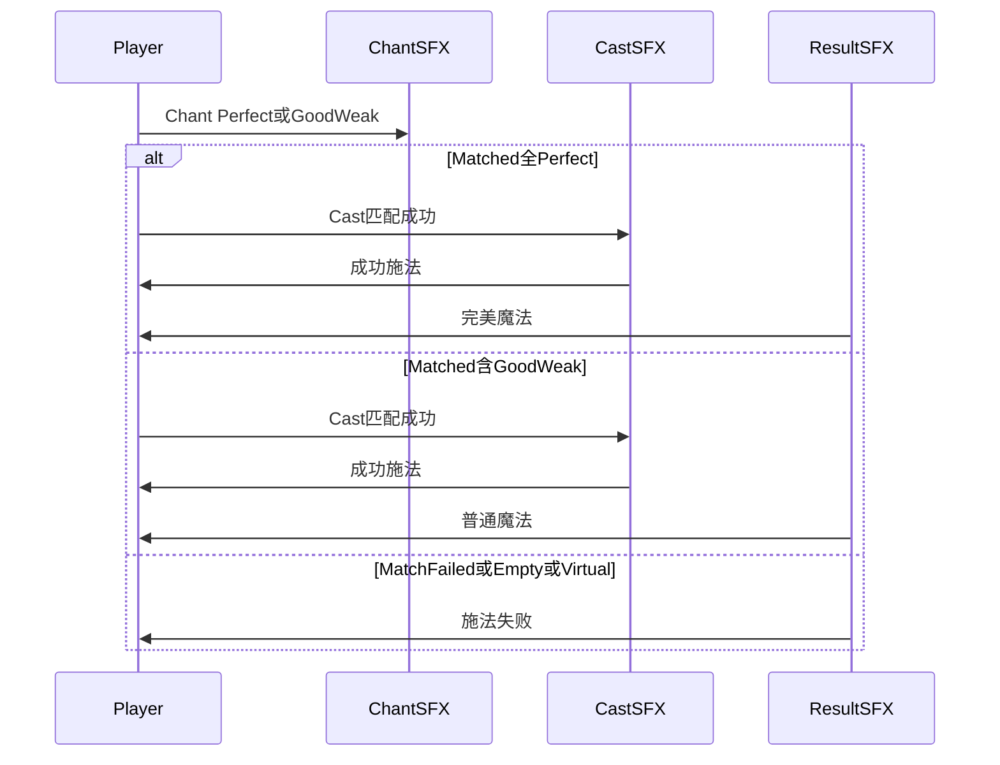

# BeatSpell 音效接入点位清单（设计向）

## 项目约束摘要（来自文档）

- **节拍真源**：局内 BGM + `AudioSettings.dspTime` 驱动 BPM；音效是**反馈层**，不改变判定（见 [`.cursor/plans/beatspell_原型系统_7b571e70.plan.md`](.cursor/plans/beatspell_原型系统_7b571e70.plan.md)、[`Assets/Docs/项目跟进plan.md`](Assets/Docs/项目跟进plan.md)）。
- **输入**：`咏唱(Chant)` / `施法(Cast)`；准确度 `Perfect / Good / Weak`（旧 Miss 打断已废弃）。
- **咏唱无失败**：没有「咏唱失败」音效场景；Weak 仍入队，只影响伤害倍率与 UI。
- **施法失败**（文档明确要求动画 + 音效，且**音效一次性播完、不因后续 Chant 取消动画而停止**）：
  - 空施法（无咏唱序列按 Cast）→ `EmptyCastPenalty`
  - 配方不匹配 → `MatchFailed`
  - 一圈生命周期结束未主动 Cast → `VirtualCastFailed`（`OnVirtualCastFailed`）
- **施法成功**：`SpellMatcher` 匹配成功 → `Matched`；全 Perfect → 伤害 100%；含 Good/Weak → 统一 80%（[`项目跟进plan.md`](Assets/Docs/项目跟进plan.md) 小步 4）。
- **尚未有音效资源的系统**（文档已占位）：BGM、敌人 BPM 预警/攻击/受击、玩家受击、胜负界面、角色层动画（跟进文档「节拍 UI 帧动画」小节末尾列表）。

## 现有音效资源

| 文件 | 语义（从命名推断） |
|------|-------------------|
| [`轻_挥剑_普通咏唱.wav`](Assets/Audio/轻_挥剑_普通咏唱.wav) | 咏唱输入，非 Perfect 档 |
| [`重_挥剑_完美咏唱.wav`](Assets/Audio/重_挥剑_完美咏唱.wav) | 咏唱输入，Perfect 档 |
| [`成功施法.wav`](Assets/Audio/成功施法.wav) | 施法键/施法动作成功感 |
| [`完美魔法.wav`](Assets/Audio/完美魔法.wav) | 魔法释放成功且「全 Perfect」结果 |
| [`普通魔法.wav`](Assets/Audio/普通魔法.wav) | 魔法释放成功但含 Good/Weak |
| [`施法失败.wav`](Assets/Audio/施法失败.wav) | 各类施法失败反馈 |

当前 [`Assets/Audio`](Assets/Audio) **仅有上述 SFX**，**无 BGM Clip**；BGM 需另配资源或在场景中已有 AudioSource 上单独指定。

---

## 一、必须接入（与现有 6 条资源一一对应）

### 1. 每次有效「咏唱」输入（Chant）

**触发时机**：玩家按下咏唱键且输入未被 `InputRejected` 拦截（空施法半拍封锁期内不播咏唱音）。

**选曲规则**（与 [`RhythmJudge`](Assets/Scripts/Rhythm/RhythmJudge.cs) 档位一致）：

- **Perfect** → `重_挥剑_完美咏唱.wav`
- **Good 或 Weak** → `轻_挥剑_普通咏唱.wav`

**体验说明**：多段咏唱（火焰/半拍/四分之一拍测试配方 [`Assets/Data/Spells/`](Assets/Data/Spells/)）每次 Chant 各播一次；与音轨黄色 Chant Marker、咏唱 UI 帧动画同帧触发即可。

**明确不需要**：咏唱过期 `ChantExpired`、虚拟失败后的「取消失败动画」——**都不属于咏唱失败音**（文档：咏唱本身无失败概念）。

---

### 2. 「施法」输入（Cast）——仅匹配成功时播「成功施法」

**触发时机**：玩家在**已有咏唱生命周期**内按 Cast，且匹配结果为 **`Matched`**（不是空施法、不是 `MatchFailed`）。

**资源**：`成功施法.wav`

**与 UI 对齐**：匹配成功时，与入队黑色 Cast Marker、施法 UI 帧动画（变体 A/B）同一反馈时刻播放。

**已确认规则**：若该次 Cast 最终为 **`MatchFailed`**，**只播放** `施法失败.wav`，**不播放** `成功施法.wav`（避免「先成功再失败」叠音）。UI 仍可保留 Cast Marker / 施法帧动画，但听感应单一失败反馈。

---

### 3. 魔法匹配成功（Matched）——结果音

**触发时机**：[`SpellCaster.LogMatched`](Assets/Scripts/Spell/SpellCaster.cs) / `OnSpellCast` 表示配方匹配成功、即将结算伤害（火焰/半拍/四分之一拍**共用**同一套，不按 `SpellId` 分轨）。

**选曲规则**（与 `damageFactor` / accuracy 一致）：

- **整段序列全部 Perfect**（`damageFactor = 1`）→ `完美魔法.wav`
- **序列中存在 Good 或 Weak**（`damageFactor = 0.8`）→ `普通魔法.wav`

**体验说明**：这是「魔法生效」层，宜略晚于或叠在 `成功施法` 之后，与敌人扣血、未来受击/特效同一 beat 感知。

---

### 4. 施法失败（Cast 失败）——统一失败音

**资源**：`施法失败.wav`（文档要求 **PlayOneShot 类一次性播放**，后续 Chant 只打断失败**动画**，不打断此音）。

**必须播放的场景**：

| 场景 | 日志/事件 | 玩家感知 |
|------|-----------|----------|
| 空施法 | `EmptyCastPenalty` | 无咏唱按 Cast；音轨短效黑 Cast 痕 + 半拍封锁 |
| 配方错误 | `MatchFailed` | 有咏唱但间隔/类型不匹配，缓冲清空；**仅此条失败音** `施法失败`，无 `成功施法` |
| 一圈未施法 | `VirtualCastFailed` / `OnVirtualCastFailed` | 队首转满 4 拍未主动 Cast；连续 Chant 跨圈时也可能瞬时触发 |

**与 UI 对齐**：

- 空施法 / 连续 Cast 替换失败残留：短效或失败 Cast Marker 出现时（[`项目跟进plan.md`](Assets/Docs/项目跟进plan.md)「施法失败残留 Marker」）。
- 虚拟失败：角色施法失败动画入口（跟进文档写明「后续接 AudioSource 时订阅 `OnVirtualCastFailed`」——此处即 **`施法失败.wav`**）。

**建议不播放**：

- `InputRejected`（封锁期内乱按）：文档无失败音要求；**无对应资源**，可保持静音或以后加「轻拒音」。
- `ChantExpired`：仅清缓冲/UI，**不是施法失败**（除非策划刻意合并，与冻结 plan 不一致则不推荐）。

---

## 二、建议接入时机（流程图）

---

## 三、文档已规划、但当前 Audio 文件夹**没有**资源的位置（接入清单占位）

以下在 [`项目跟进plan.md`](Assets/Docs/项目跟进plan.md) / 主 plan 中出现，**本轮 6 个 WAV 不覆盖**；做完整 Demo 时需要额外音效或音乐：

1. **战斗 BGM**：节拍时钟来源；战斗房间持续播放（非 SFX，通常单独 AudioSource）。
2. **第 5 轮敌人**：攻击**预警**、攻击**命中**、敌人**受击**、玩家**受击/扣血**（[`EnemyCombatController`](Assets/Scripts/) 规划）。
3. **胜负流程**：`Victory` / 未来玩家死亡失败（`BattleGameManager` 仅胜利闭环，失败未做）。
4. **角色动画层**（与 UI 帧动画并列）：待机/咏唱/施法/失败**动画**——音效上仍复用上文 Chant/Cast/魔法/失败四组，除非后续加「脚步/衣摆」环境音。
5. **UI 纯视觉**：当前拍 `BeatPulse`、Perfect Ring 旋转闪烁——文档未要求点击音；**默认不接**现有资源。
6. **Hint / 血条 / 暂停 / 统计**：低优先级，无现成 Clip。

---

## 四、与 Inspector / 场景相关的非代码提醒

- 玩家（及未来敌人）身上需 **至少区分**：BGM 用 AudioSource（若已有）、一次性 SFX 用可重叠播放的源（文档已点名 PlayOneShot 思路）。
- [`DemoScene`](Assets/Scenes/) / `RhythmPrototype` 战斗闭环验证时，可按 Console 前缀对照听感：`[Beat]` 输入档、`[Spell] Matched/MatchFailed/VirtualCastFailed/EmptyCastPenalty`。

---

## 五、验收听感检查表（策划向）

- 单发 Perfect 火焰：`Chant(重)` → `Cast(成功施法)` → `完美魔法`，敌人扣血。
- Good 火焰：`Chant(轻)` 或混合 → `成功施法` → `普通魔法`，伤害 80%。
- 错误配方 Cast（`MatchFailed`）：仅 `施法失败`，**无** `成功施法` / 魔法结果音。
  - **举例（火焰 `Fireball_Lv1`）**：玩家按对了咏唱节拍（例如首下 `Chant` 为 Perfect → 已播 `Chant（重）`），但 **Cast 时机或整段间隔不符合配方**（如该在 1 拍后 Cast 却提前/拖拍，或多/少了一段 Chant，导致 `SpellMatcher` 判 `MatchFailed`）。此时听感应为：**不再补** `成功施法` 或 `完美魔法`/`普通魔法`，**只以本次 Cast 的结论音** `施法失败` 收束；之前的 Perfect 咏唱重音仍保留，不收回。
- 空 Cast：`施法失败`，无魔法结果音。
- `Chant×N` 不 Cast 满一圈：`施法失败` 播完；下一发 Chant 可打断失败动画但**失败音仍完整**。
- 连续两次空 Cast：仅保留最后一次失败反馈 UI，**每次失败仍可各播一次** `施法失败`（或策划限制不叠音——文档未限制）。
