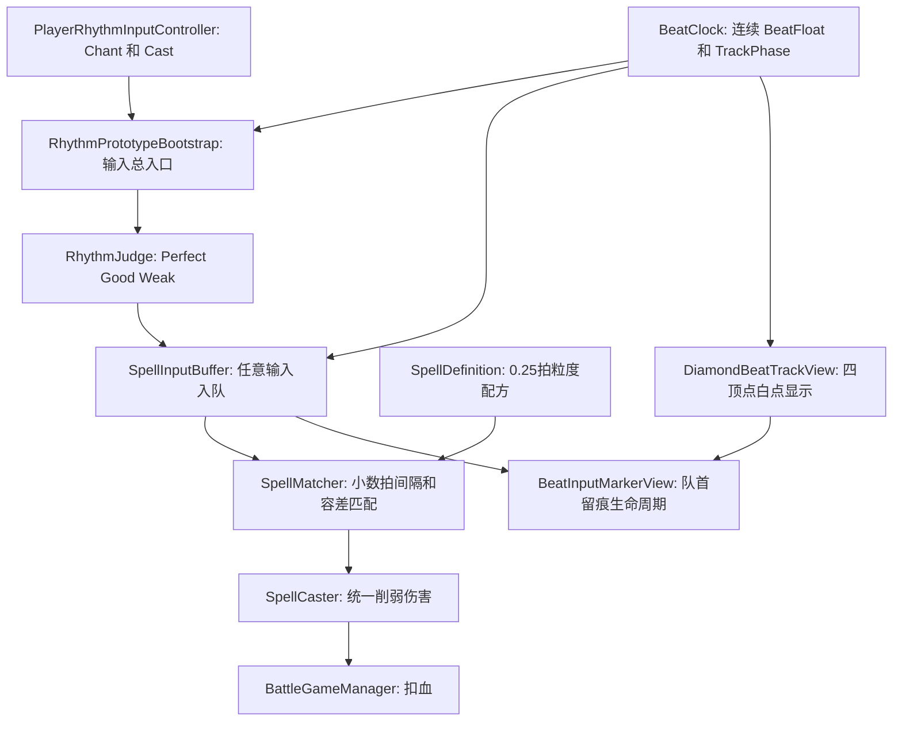

# 第4轮魔法系统完整补完计划

## 目标

本轮不进入第 5 轮敌人节拍攻击，先完整补齐第 4 轮魔法输入模型：

- 魔法配方支持 `0.5` 拍、`0.25` 拍等非整数间隔。
- 玩家任意时刻都能咏唱/施法，输入不再因为 `Miss` 被打断；节拍准确度只影响伤害和 UI 反馈。
- 魔法释放仍有配方匹配边界：输入类型、数量、相邻间隔必须在最大误差阈值内，超出阈值则匹配失败。
- 留痕改为队列模型：队首输入点作为生命周期参考，底层当前节拍相位绕一圈后与队首相位相交时清空缓存和 UI；当前白点 UI 继续只在四个顶点显示。

## 新规则整理

需要写入 [.cursor/plans/beatspell_原型系统_7b571e70.plan.md](.cursor/plans/beatspell_原型系统_7b571e70.plan.md) 的规则变更：

- 旧规则“`Miss` 立刻打断当前咏唱”废弃。
- `Perfect / Good / Weak` 只表示准确度，不表示能否接收输入。
- `Perfect` 输入显示放射线段并给最大伤害；非 Perfect 暂时统一使用一个削弱系数，后续再按偏移量做连续伤害曲线。
- 魔法能否成功释放由 `SpellMatcher` 判断：类型序列一致，且相邻输入间隔与配方间隔的差值小于等于 `matchToleranceBeats`。
- 音轨 UI 仍不驱动判定；白色当前节拍点保持现有四顶点跳动显示。`BeatClock` 连续相位只用于小数拍匹配与队首生命周期判断，不新增沿边连续移动的白色游标。
- **空施法（无咏唱序列时按 Cast）**：仍触发 `[Spell] EmptyCastPenalty` 与约半拍 `InputRejected`；**不入** `SpellInputBuffer`、不参与匹配。但须在音轨上留下**黑色底施法留痕**（与成功入队的 Cast Marker 同款），让玩家看见「这一下是施法输入」。

## 接入架构图

## 迭代拆分

### 小步 1：节拍时间模型支持小数拍

修改 [Assets/Scripts/Rhythm/BeatClock.cs](Assets/Scripts/Rhythm/BeatClock.cs) 和 [Assets/Scripts/Rhythm/BeatTimingGrade.cs](Assets/Scripts/Rhythm/BeatTimingGrade.cs)：

- 给 `BeatTimingInfo` 增加连续字段：`BeatFloat`、`TrackPhase`。
- `BeatFloat = (dspNow - songStartDspTime) / secondsPerBeat`，`TrackPhase = BeatFloat % 4`。
- 保留 `BeatIndex` / `VertexIndex` 给现有四顶点白点 UI 和日志兼容，但后续匹配不再依赖整数 `BeatIndex`。
- 把 `Miss` 语义替换为 `Weak` 或等价弱命中档位；如果为了减少一次性破坏可先保留枚举名，但不得再用于打断咏唱。

关键问题来源：当前 `BeatClock.GetTimingAt` 只暴露整数拍与相对最近整数拍的 `DeltaMs`，无法表达 0.5 / 0.25 拍配方。

### 小步 2：输入准确度不再打断

修改 [Assets/Scripts/Rhythm/RhythmJudge.cs](Assets/Scripts/Rhythm/RhythmJudge.cs)、[Assets/Scripts/Spell/SpellInputBuffer.cs](Assets/Scripts/Spell/SpellInputBuffer.cs)、[Assets/Scripts/Debug/RhythmPrototypeBootstrap.cs](Assets/Scripts/Debug/RhythmPrototypeBootstrap.cs)：

- `RhythmJudge` 只输出准确度：`Perfect / Good / Weak`。
- `SpellInputBuffer.TryAppend` 删除 `grade == Miss` 时 `Clear()` 和 `ChantBroken` 的路径。
- 任意咏唱/施法都能入队，除非仍处于“空施法半拍封锁”这种结构性惩罚。
- 空施法惩罚保留：无咏唱序列时 Cast **不入缓冲**，但须走准确度判定（`[Beat] Cast | Perfect/Good/Weak`）并在 [BeatInputMarkerView](Assets/Scripts/UI/BeatInputMarkerView.cs) 生成**黑色施法留痕**；随后约半拍内任意输入仍 `InputRejected`。
- 实现要点（[RhythmPrototypeBootstrap.ProcessInput](Assets/Scripts/Debug/RhythmPrototypeBootstrap.cs)）：空施法分支在 `return` 前调用「仅 UI」的 Cast 留痕（`beatFloat` + `castSprite`），不调用 `TryAppend`；封锁期内不再留痕。

关键问题来源：当前 [Assets/Scripts/Spell/SpellInputBuffer.cs](Assets/Scripts/Spell/SpellInputBuffer.cs) 中 `grade == BeatTimingGrade.Miss` 会清空序列，这与“任意时刻都能咏唱施法”冲突（小步 2 已移除）。空施法当前早退且不留痕，与「黑色施法 UI 反馈」冲突（见上补丁）。

### 小步 2 补丁：空施法黑色留痕（与半拍封锁并存）

- 无 `HasActiveChantLifecycle` 时按 Cast：顺序为 `EvaluateLifecycle` → 判定 `RhythmJudge`（可选：先判再罚，便于 `[Beat]` 与放射线规则一致）→ `[Spell] EmptyCastPenalty` + 设置 `blockedUntilDspTime` → **Spawn Cast Marker（黑）** → `return`（不 `TryAppend`）。
- 空施法黑色留痕是**短效反馈 Marker**，不属于咏唱/施法队列 Marker，不参与队首“一圈后清空”的生命周期。
- 短效 Marker 的自销毁时间 = 本次空施法造成的输入无效时间，即 `EmptyCastPenaltySeconds`（默认 `emptyCastPenaltyBeats * SecondsPerBeat`，当前约半拍）。
- 优雅接入要求：
  - [BeatInputMarkerView](Assets/Scripts/UI/BeatInputMarkerView.cs) 增加独立 API，例如 `ShowTransientCastMarker(BeatTimingInfo timing, float lifeSeconds)`。
  - 队列留痕仍由 `SpellInputBuffer.OnEntryAdded` 驱动；短效空施法留痕由 `RhythmPrototypeBootstrap` 直接调用 UI API。
  - 短效 Marker 可复用 `castSprite` 和 `SpawnMarker` 内部生成逻辑，但应以独立列表/句柄管理，避免污染 `spawnedMarkers` 的队首生命周期。
  - 测试查询中应能区分队列 Marker 数与短效 Marker 数；最少需要保留 `LastMarkerKind == "Cast"` 供 MCP 验收。
- 半拍封锁内：维持现有 `InputRejected`，**不**入缓冲、**不**新增 Marker。
- MCP 增补（用例 I 修订）：
  - 无咏唱 `Cast beat=0 offset=0` → `EmptyCastPenalty`，`IsInputBlocked=true`，`BufferCount=0`，`HasActiveChantLifecycle=false`，**短效 Cast Marker=1 且末点为 Cast**。
  - 封锁内 `Chant beat=0 offset=100ms` → `InputRejected`，短效 Marker 仍为 1，队列 Marker 仍为 0。
  - 推进时间到 `EmptyCastPenaltySeconds` 之后 → 短效 Cast Marker 自动销毁，短效 Marker=0，不影响后续咏唱队列。

### 小步 3：魔法配方支持半拍和 1/4 拍

修改 [Assets/Scripts/Spell/SpellDefinition.cs](Assets/Scripts/Spell/SpellDefinition.cs)、[Assets/Scripts/Spell/RhythmInputEntry.cs](Assets/Scripts/Spell/RhythmInputEntry.cs)、[Assets/Scripts/Spell/SpellMatcher.cs](Assets/Scripts/Spell/SpellMatcher.cs)：

- `RhythmInputEntry` 增加 `BeatFloat`，把 `IntervalBeatsFromPrevious` 从 `int` 改为 `float`。
- `SpellDefinition` 的 `intervalsBetweenSteps` 从 `int[]` 改为 `float[]`，Inspector 中可填 `1`、`0.5`、`0.25`。
- 增加 `matchToleranceBeats`，建议默认 `0.125` 拍，也就是 1/8 拍容差。
- `SpellMatcher` 用 `abs(actualInterval - expectedInterval) <= tolerance` 判断，而不是整数相等。
- 新增测试配方：
  - `Fireball_Lv1`：`Chant -> 1.0拍 -> Cast`
  - `HalfBeat_Test`：`Chant -> 0.5拍 -> Chant -> 0.5拍 -> Cast`
  - `QuarterBeat_Test`：`Chant -> 0.25拍 -> Cast`

### 小步 4：统一削弱伤害，不再因 Weak 归零

修改 [Assets/Scripts/Spell/SpellMatcher.cs](Assets/Scripts/Spell/SpellMatcher.cs) 和 [Assets/Scripts/Spell/SpellCaster.cs](Assets/Scripts/Spell/SpellCaster.cs)：

- 匹配成功后，如果全部输入都是 `Perfect`，`damageFactor = 1.0`。
- 只要有任意非 Perfect 输入，先统一 `damageFactor = 0.8`。
- 不再出现 `Weak/Miss -> damageFactor=0` 的逻辑。
- Console 日志建议输出：`[Spell] Matched Fireball | accuracy=Mixed | damageFactor=0.8`。

### 小步 5：重做留痕生命周期和视觉等级

修改 [Assets/Scripts/UI/DiamondBeatTrackView.cs](Assets/Scripts/UI/DiamondBeatTrackView.cs) 和 [Assets/Scripts/UI/BeatInputMarkerView.cs](Assets/Scripts/UI/BeatInputMarkerView.cs)：

- `DiamondBeatTrackView` 保留现有当前节拍点 UI：白点只在 Top / Right / Bottom / Left 四个顶点跳动，不新增沿边连续移动的白色游标。
- `BeatClock.TrackPhase` 仍保留为规则层数据，用于判断“底层当前节拍位置”是否绕回队首输入相位；它不直接改变当前白点 UI 的显示模式。
- `BeatInputMarkerView` 不再用固定秒数简单清理，而是记录队首 `BeatFloat` / `TrackPhase`。
- 当当前 `BeatFloat >= headBeatFloat + 4`，说明底层节拍相位绕一圈回到队首输入点，清空输入缓存和 Marker。
- Marker 样式按准确度区分：`Perfect` 显示黄色底 + 放射线段；`Good/Weak` 显示黄色底但不显示放射线段。
- 队首清理必须由核心节拍数据判断，不能由 UI 碰撞或图片位置反推。

### 小步 6：文档同步

实现前先更新 [.cursor/plans/beatspell_原型系统_7b571e70.plan.md](.cursor/plans/beatspell_原型系统_7b571e70.plan.md)：

- 替换“Miss 打断”旧规则。
- 加入“第4轮魔法系统完整补完计划”章节，收录用户这次提出的 3 个问题和解决方向。
- 更新原型成功标准：从“玩家按咏唱/施法可获得 Perfect/Good/Miss”改为“输入可获得准确度反馈，任意输入可入队，魔法用配方容差匹配”。
- 本轮实施完成后再写入 MCP 验收记录。

## Agent + UnityMCP 验收

编译门禁：

- `Unity_GetConsoleLogs` 无编译错误。

核心用例：

- A：`Chant beat=0 offset=0` 入队，准确度 `Perfect`，Marker 有放射线。
- B：`Chant beat=0 offset=200ms` 也入队，不触发 `ChantBroken`，Marker 无放射线。
- C：`Fireball_Lv1`：`Chant beat=0` + `Cast beat=1` 匹配成功，`damageFactor=1.0`。
- D：`Fireball_Lv1`：`Chant beat=0` + `Cast beat=1 offset=80ms` 匹配成功，`damageFactor=0.8`。
- E：`HalfBeat_Test`：`Chant beat=0` + `Chant beat=0.5` + `Cast beat=1.0` 匹配成功。
- F：`QuarterBeat_Test`：`Chant beat=0` + `Cast beat=0.25` 匹配成功。
- G：超出容差：`QuarterBeat_Test` 的 Cast 输入偏离超过 `matchToleranceBeats`，匹配失败但不是因为 `Miss` 打断。
- H：队首生命周期：首个输入在 `beatFloat=0.25`，底层当前节拍推进到 `4.24` 时不清，推进到 `4.25` 或之后清空缓存和 Marker；白点 UI 仍只在四顶点跳动。
- I：空施法半拍封锁仍有效：无咏唱直接 Cast → `EmptyCastPenalty` + **音轨 1 个黑色 Cast 留痕** + 缓冲仍为 0；封锁内输入 `InputRejected` 且不再增 Marker；封锁结束后可重新咏唱/施法。

完成标准：

- 所有用例通过并输出 `[Beat]` / `[Spell]` / `[Track]` 前缀日志。
- `Fireball_Lv1` 原有整数拍释放和扣血链路不回退。
- `.cursor/plans/beatspell_原型系统_7b571e70.plan.md` 完成同步，且本轮 todo 状态只在 MCP 通过后标记。