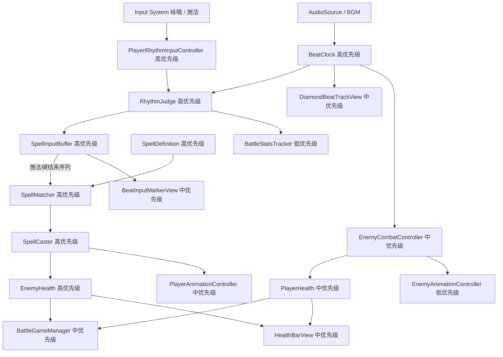

# BeatSpell 音乐节奏原型计划

## 已确认玩法规则
- 玩家在战斗房间中根据局内 BGM 的 BPM 输入节拍。
- 输入分为两个动作：`咏唱` 和 `施法`，两者都参与节拍判定。
- 每次输入都基于全局 BPM 时间轴判定为 `Perfect`、`Good` 或 `Miss`。
- `Miss` 会立刻打断当前咏唱，清空输入序列，本次魔法失败。
- 玩家先进行若干次咏唱，最后通过施法键结束序列并尝试释放魔法。
- 魔法识别推荐使用“输入类型序列 + 输入间隔拍数”，而不是依赖菱形 UI 的绝对顶点。
- 菱形音轨只是 UI 可视化辅助：四个顶点依次显示当前完美节拍点，输入判定不依赖 UI 本身。
- 敌人也跟随 BPM 行动，例如提前若干拍播放攻击预警，在指定节拍点执行攻击。

## 推荐核心判定模型
- 使用 `AudioSettings.dspTime` 作为节拍时钟基础，避免普通 `Time.time` 带来的音频同步误差。
- 根据 `BPM` 计算每拍长度：`secondsPerBeat = 60f / bpm`。
- 玩家按键时，计算输入时间距离最近理论节拍点的偏差。
- 判定窗口建议初始值：
  - `Perfect`：约 ±50ms
  - `Good`：约 ±120ms
  - `Miss`：超过 Good 窗口
- 魔法匹配示例：
  - 火焰魔法（Demo）：`咏唱(J) -> 1拍 -> 施法(K)`；图标顶黄=咏唱、右黑=施法（可视化，判定看类型+间隔）
  - 治疗术：`咏唱(J)  -> 半拍 -> 咏唱(J)  -> 半拍 -> 施法(K)`
  - 雷击术：`咏唱 -> 1拍 -> 咏唱 -> 1拍 -> 咏唱 -> 1拍 -> 施法`
- 伤害结算建议：全部 Perfect 为 100%，含 Good 无 Miss 时降低到 70% 到 90%，任意 Miss 为 0。

## 原型架构图

## 优先级说明
- 高优先级：决定玩法是否成立，先实现并用 Console 或简单文本验证，不依赖最终美术和复杂 UI。
- 中优先级：决定游戏是否像截图中的目标体验，包括菱形音轨、血量、敌人节拍攻击和动画触发。
- 低优先级：锦上添花或统计性质内容，包括完整动画包装、战斗统计、暂停界面和 Buff 系统。
- 开发时不要先追求完整视觉效果；先证明“听 BPM 输入 -> 判定 -> 匹配魔法 -> 造成伤害”这条链路稳定。

## 系统拆分建议
- 节拍系统
  - `BeatClock`：维护 BPM、当前拍号、当前四顶点索引、输入偏差计算。
  - `RhythmJudge`：根据偏差输出 `Perfect / Good / Miss`。
  - `PlayerRhythmInputController`：接收咏唱/施法输入，不在 `Update` 中反复 `GetComponent`。
  - 第 1 轮实测：默认 BPM 120、Perfect ±50ms、Good ±120ms、`dspOffsetMs=0`。键盘 `J` 咏唱、`K` 施法（手柄 South/East）。无 Clip 自动起跑；有 Clip 时 `StartClock` 会 `AudioSource.Play`。验收：offset 0=Perfect、80=Good、200=Miss；把 Good 窗口收到 70ms 后 80ms 变为 Miss。Play 时在 Game 窗口试按 J/K 看 Console `[Beat]` 日志。
- 魔法系统
  - `SpellDefinition`：用 ScriptableObject 配置魔法名、等级、基础伤害、输入步骤和间隔。
  - `SpellInputBuffer`：记录当前咏唱到施法期间的输入序列。
  - `SpellMatcher`：在施法时匹配魔法定义。
  - `SpellCaster`：执行伤害、动画和反馈。
  - 第 2 轮实测：`Fireball_Lv1` 为 `Chant → 1拍 → Cast`；MCP 用例 1–5 通过（Matched 1.0 / Matched 0.8 / ChantBroken / MatchFailed / SequenceInvalid）。
- 玩家系统
  - `PlayerCombatController`：整合输入、咏唱状态、施法结果。
  - `PlayerHealth`：管理玩家生命值。
  - `PlayerAnimationController`：播放待机、咏唱、施法、Miss 动画。
- 敌人系统
  - `EnemyCombatController`：根据拍号调度攻击预警和攻击瞬间。
  - `EnemyHealth`：管理敌人生命值和死亡。
  - `EnemyAnimationController`：播放待机、预警、攻击、受击动画。
  - 第 3 轮实测：默认 `maxHealth=20`。`Fireball` Perfect 伤害 10、Good 伤害 8。`SampleScene` 的 `RhythmPrototype/Enemy` 挂 `EnemyHealth`。MCP 用例 1–6 通过（Perfect 剩 10 / Good 剩 12 / Miss 不扣 / MatchFailed 不扣 / 两发 Perfect 击败 / 死后 `Ignored`）。反击与受击动画未做。
- UI 系统
  - `DiamondBeatTrackView`：显示四边、四顶点、中点，以及当前完美节拍点。
  - `BeatInputMarkerView`：显示玩家输入留下的黄色咏唱点、黑色施法点。
  - `HealthBarView`：玩家和敌人血量显示。
  - `HintTextView`：显示操作提示和判定结果。
- 全局系统
  - `BattleGameManager`：控制战斗开始、胜利、失败、暂停。
  - `BattleStatsTracker`：记录通关时间、Perfect 次数、Good 次数、Miss 次数。
  - Buff 系统先预留接口，Demo 初期不作为第一优先级。
  - 第 3 轮实测：`BattleGameManager` 已订阅 `SpellCaster.OnSpellCast` 转发扣血；敌人死亡只打一次 `[Battle] Victory`。失败、暂停、统计未做。`RhythmPrototypeBootstrap.ResetCombat()` 供 MCP 复用。

## 实现顺序
1. 先完成节拍时钟和输入判定，让没有 UI 的情况下也能在 Console 中输出 `Perfect / Good / Miss`。
2. 再实现输入序列缓存和魔法匹配，能用咏唱/施法按键释放 1 到 2 个测试魔法。
3. 接着接入玩家和敌人血量，完成“按节拍施法造成伤害，击败敌人”的闭环。第 3 轮已完成敌人扣血与击败；`PlayerHealth`、失败流程仍待后续轮。
4. 然后制作菱形音轨 UI，让当前节拍点和玩家输入点可视化。
5. 最后接入敌人 BPM 攻击、动画占位、暂停和战斗统计。

## Plan 开发与验收规范（必守）

**之后每一轮 Plan 都必须包含「Agent + UnityMCP 验收」章节，且实现完成前不得收口。**

| 要求 | 说明 |
|------|------|
| Plan 文档 | 每轮计划需写清：前置条件、MCP 步骤顺序、用例表、通过标准、失败排查；可参考第 1/2 轮计划中的验收流程。 |
| Agent 执行 | 编码/改场景后，Agent **必须**调用 UnityMCP：`Unity_GetConsoleLogs`（编译门禁）→ `Unity_RunCommand`（场景/组件/自动化用例）→ 必要时再拉日志核对 `[Beat]` / `[Spell]` 等前缀。 |
| 测试 API | 若功能依赖 Play 或按键，Plan 应要求提供 **Editor/Play 可调用测试入口**（如 `SimulateStep`），避免 MCP 无法模拟键盘导致「未验收就完成」。 |
| 完成定义 | 仅当 MCP 用例通过 +（可选）你本地试玩确认，才将该轮 todo 标 completed 并更新本文件。 |
| 分工 | C# 逻辑手写；MCP 负责 Editor 操作、Play 模式触发、Console 取证，**不**用 MCP 替代核心玩法代码。 |

## 计划使用指南：小步迭代 vibeCoding
- 每一轮只选一个高优先级目标，不要同时要求节拍、魔法、UI、敌人全都完成。
- 每轮开始时，用一句话描述本轮目标，例如：`本轮只实现 BeatClock 和 RhythmJudge，按键时在 Console 输出 Perfect / Good / Miss`。
- 每轮都要求一个可验证结果，例如 Console 日志、Inspector 可调参数、场景中可见的 UI 变化或敌人扣血。
- **每轮 Plan 必须附带 UnityMCP 验收流程，并由 Agent 实际跑通后再标记完成（见上一节）。**
- 每轮完成后先试玩，再根据手感调整窗口参数，例如 `BPM`、`PerfectWindowMs`、`GoodWindowMs`，不要急着扩展新系统。
- 遇到体验不准时，优先检查节拍时间轴和输入判定，再检查 UI 表现；因为音轨 UI 只是辅助显示，不应该反过来驱动判定。
- 使用 UnityMCP 时，适合让它做场景搭建、对象挂载、截图检查和 Console 日志读取；核心 C# 逻辑仍按本计划分模块实现。
- 推荐迭代节奏：
  1. 第 1 轮：只做节拍时钟和输入判定。
  2. 第 2 轮：加入输入缓存和一个测试魔法。
  3. 第 3 轮：加入敌人血量和伤害结算。
  4. 第 4 轮：加入菱形音轨可视化。
  5. 第 5 轮：加入敌人按节拍攻击。
  6. 第 6 轮：补动画、统计、暂停和 Buff 预留。
- 每轮结束都更新这份计划：把已完成项标记出来，把新发现的问题写到对应系统下面，避免需求散落在聊天里。

## Unity 项目落地方式
- 当前项目已安装 `com.unity.inputsystem` 和 `com.unity.ugui`，可直接使用 Input System 绑定咏唱/施法按键，UI 使用 Canvas + UGUI 搭建。
- 脚本按模块放在 `Assets/Scripts/`；新轮次开发结束须走 **UnityMCP 验收**（见「Plan 开发与验收规范」）。
- 使用 UnityMCP 时，优先让它辅助创建场景对象、Canvas、占位 Sprite、测试 AudioSource 和组件挂载；核心判定逻辑仍放在 C# 脚本中，方便调试和扩展。

## 原型成功标准
- 播放 BGM 后，全局节拍稳定推进。
- 玩家按咏唱/施法可获得 `Perfect / Good / Miss`。
- `Miss` 会打断当前咏唱。
- 至少一个魔法可以通过节拍序列成功释放并对敌人造成伤害。（第 3 轮已用 Console 闭环验证）
- 菱形音轨能显示当前完美节拍点，以及玩家输入留下的咏唱/施法标记。
- 敌人能按 BPM 进行预警和攻击。

## 第 3 轮迭代记录
- 本轮目标：按节拍释放火焰魔法后按伤害扣敌人血，归零记一次胜利。
- 改动摘要：
  - `Assets/Scripts/Combat/EnemyHealth.cs`
  - `Assets/Scripts/Combat/BattleGameManager.cs`
  - `Assets/Scripts/Debug/RhythmPrototypeBootstrap.cs`（`ResetCombat` / 血量与胜利查询）
  - `Assets/Scenes/SampleScene.unity`：`RhythmPrototype` 挂 `BattleGameManager`，子物体 `Enemy` 挂 `EnemyHealth`（默认 20）
- MCP 验收：Play 模式 `SimulateStep` 用例 1–6 通过。前缀 `[Spell]` / `[Combat]` / `[Battle]`。Perfect 剩 10；Good 剩 12；Miss / MatchFailed 不扣血；两发 Perfect 出现一次 `Dead` + `Victory`；死后 `[Combat] Ignored | already dead`，无第二次 Victory。
- todo：`implement-combat-loop` 保持 pending（玩家血量、动画、失败/暂停未做）。
- 新问题：伤害公式仍固定 Good=0.8，未做 70%–90% 插值；血条 UI 未做，试玩请看 Inspector `Enemy.Current Health` 与 Console。