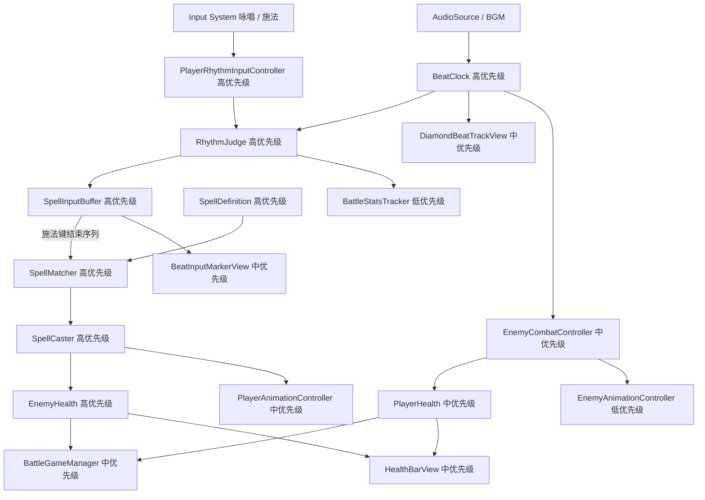

# BeatSpell 音乐节奏原型计划

## 已确认玩法规则
- 玩家在战斗房间中根据局内 BGM 的 BPM 输入节拍。
- 输入分为两个动作：`咏唱` 和 `施法`，两者都参与节拍判定。
- 每次输入都基于全局 BPM 时间轴判定为 `Perfect`、`Good` 或 `Miss`。
- `Miss` 会立刻打断当前咏唱，清空输入序列，本次魔法失败。
- 玩家先进行若干次咏唱，最后通过施法键结束序列并尝试释放魔法。
- 咏唱序列从首个有效输入起拥有一圈音轨生命周期（默认 4 拍，任意起点），期满清空缓冲与音轨留痕。
- 无咏唱时直接施法：惩罚约半拍输入封锁，期间输入 `InputRejected`、不入缓冲；**但这一次 Cast 须在音轨留黑色施法痕**（第 4 轮完整补完 plan 小步 2 补丁，代码待落地）。
- 魔法识别推荐使用“输入类型序列 + 输入间隔拍数”，而不是依赖菱形 UI 的绝对顶点。
- 菱形音轨只是 UI 可视化辅助：四个顶点依次显示当前完美节拍点，输入判定不依赖 UI 本身。
- 敌人也跟随 BPM 行动，例如提前若干拍播放攻击预警，在指定节拍点执行攻击。

## 推荐核心判定模型
- 使用 `AudioSettings.dspTime` 作为节拍时钟基础，避免普通 `Time.time` 带来的音频同步误差。
- 根据 `BPM` 计算每拍长度：`secondsPerBeat = 60f / bpm`。
- 玩家按键时，计算输入时间距离最近理论节拍点的偏差。
- 判定窗口建议初始值：
  - `Perfect`：约 ±50ms
  - `Good`：约 ±120ms
  - `Miss`：超过 Good 窗口
- 魔法匹配示例：
  - 火焰魔法（Demo）：`咏唱(J) -> 1拍 -> 施法(K)`；图标顶黄=咏唱、右黑=施法（可视化，判定看类型+间隔）
  - 治疗术：`咏唱(J)  -> 半拍 -> 咏唱(J)  -> 半拍 -> 施法(K)`
  - 雷击术：`咏唱 -> 1拍 -> 咏唱 -> 1拍 -> 咏唱 -> 1拍 -> 施法`
- 伤害结算（第 4 轮小步 4 已落地）：匹配成功后全 Perfect 为 100%，含任意 Good/Weak 先统一 80%；匹配失败不扣血。

## 原型架构图

## 优先级说明
- 高优先级：决定玩法是否成立，先实现并用 Console 或简单文本验证，不依赖最终美术和复杂 UI。
- 中优先级：决定游戏是否像截图中的目标体验，包括菱形音轨、血量、敌人节拍攻击和动画触发。
- 低优先级：锦上添花或统计性质内容，包括完整动画包装、战斗统计、暂停界面和 Buff 系统。
- 开发时不要先追求完整视觉效果；先证明“听 BPM 输入 -> 判定 -> 匹配魔法 -> 造成伤害”这条链路稳定。

## 系统拆分建议
- 节拍系统
  - `BeatClock`：维护 BPM、当前拍号、当前四顶点索引、输入偏差计算。
  - `RhythmJudge`：根据偏差输出 `Perfect / Good / Miss`。
  - `PlayerRhythmInputController`：接收咏唱/施法输入，不在 `Update` 中反复 `GetComponent`。
  - 第 1 轮实测：默认 BPM 120、Perfect ±50ms、Good ±120ms、`dspOffsetMs=0`。键盘 `J` 咏唱、`K` 施法（手柄 South/East）。无 Clip 自动起跑；有 Clip 时 `StartClock` 会 `AudioSource.Play`。验收：offset 0=Perfect、80=Good、200=Miss；把 Good 窗口收到 70ms 后 80ms 变为 Miss。Play 时在 Game 窗口试按 J/K 看 Console `[Beat]` 日志。
- 魔法系统
  - `SpellDefinition`：用 ScriptableObject 配置魔法名、等级、基础伤害、输入步骤和间隔。
  - `SpellInputBuffer`：记录当前咏唱到施法期间的输入序列。
  - `SpellMatcher`：在施法时匹配魔法定义。
  - `SpellCaster`：执行伤害、动画和反馈。
  - 第 2 轮实测：`Fireball_Lv1` 为 `Chant → 1拍 → Cast`；MCP 用例 1–5 通过（Matched 1.0 / Matched 0.8 / ChantBroken / MatchFailed / SequenceInvalid）。
  - 第 4 轮补完：允许多段 Chant；首个有效咏唱的 dsp 起算 `chantLifetimeBeats=4`；空 Cast 触发 `emptyCastPenaltyBeats=0.5` 封锁。MCP 用例 A–G 通过。
  - 第 4 轮小步 3：配方间隔改为 `float[]`，`matchToleranceBeats=0.125`；`Fireball_Lv1` / `HalfBeat_Test` / `QuarterBeat_Test` 已挂到 `spellCatalog`。
- 玩家系统
  - `PlayerCombatController`：整合输入、咏唱状态、施法结果。
  - `PlayerHealth`：管理玩家生命值。
  - `PlayerAnimationController`：播放待机、咏唱、施法、Miss 动画。
- 敌人系统
  - `EnemyCombatController`：根据拍号调度攻击预警和攻击瞬间。
  - `EnemyHealth`：管理敌人生命值和死亡。
  - `EnemyAnimationController`：播放待机、预警、攻击、受击动画。
  - 第 3 轮实测：默认 `maxHealth=20`。`Fireball` Perfect 伤害 10、Good 伤害 8。`SampleScene` 的 `RhythmPrototype/Enemy` 挂 `EnemyHealth`。MCP 用例 1–6 通过（Perfect 剩 10 / Good 剩 12 / Miss 不扣 / MatchFailed 不扣 / 两发 Perfect 击败 / 死后 `Ignored`）。反击与受击动画未做。
- UI 系统
  - `DiamondBeatTrackView`：显示四边、四顶点、中点，以及当前完美节拍点。
  - `BeatInputMarkerView`：显示玩家输入留下的黄色咏唱点、黑色施法点。
  - `HealthBarView`：玩家和敌人血量显示。
  - `HintTextView`：显示操作提示和判定结果。
  - 第 4 轮实测（重做）：当前拍只读 `BeatClock.VertexIndex`，四顶点整拍跳动。输入留痕用 `beatFloat` 在菱形边上插值，不吸附 4/8 点。`MarkerRoot` 动态生成黄/黑点。匹配成功 `Clear(notify:false)` 保留本序列痕迹；`MatchFailed` / `ResetCombat` 清空。Miss 打断序列后仍在本次按键轨迹位置留一点。血条与侧栏技能菱形未做。
  - 第 4 轮补完：Marker 从首个留痕起算一圈后 `ClearMarkers`；新一轮咏唱会先清掉上一轮残留。过期前缀 `[Track] MarkersCleared`。
  - 第 4 轮小步 5：队首清理改由 `BeatFloat >= headBeatFloat + 4` 判断；`Perfect` 队列 Marker 动态生成放射线，`Good/Weak` 只有底图。白点仍只读 `VertexIndex`。
- 全局系统
  - `BattleGameManager`：控制战斗开始、胜利、失败、暂停。
  - `BattleStatsTracker`：记录通关时间、Perfect 次数、Good 次数、Miss 次数。
  - Buff 系统先预留接口，Demo 初期不作为第一优先级。
  - 第 3 轮实测：`BattleGameManager` 已订阅 `SpellCaster.OnSpellCast` 转发扣血；敌人死亡只打一次 `[Battle] Victory`。失败、暂停、统计未做。`RhythmPrototypeBootstrap.ResetCombat()` 供 MCP 复用。

## 实现顺序
1. 先完成节拍时钟和输入判定，让没有 UI 的情况下也能在 Console 中输出 `Perfect / Good / Miss`。
2. 再实现输入序列缓存和魔法匹配，能用咏唱/施法按键释放 1 到 2 个测试魔法。
3. 接着接入玩家和敌人血量，完成“按节拍施法造成伤害，击败敌人”的闭环。第 3 轮已完成敌人扣血与击败；`PlayerHealth`、失败流程仍待后续轮。
4. 然后制作菱形音轨 UI，让当前节拍点和玩家输入点可视化。第 4 轮重做已闭环中央音轨；血条 / Hint 仍待后续。
5. 最后接入敌人 BPM 攻击、动画占位、暂停和战斗统计。

## Plan 开发与验收规范（必守）

**之后每一轮 Plan 都必须包含「Agent + UnityMCP 验收」章节，且实现完成前不得收口。**

| 要求 | 说明 |
|------|------|
| Plan 文档 | 每轮计划需写清：前置条件、MCP 步骤顺序、用例表、通过标准、失败排查；可参考第 1/2 轮计划中的验收流程。 |
| Agent 执行 | 编码/改场景后，Agent **必须**调用 UnityMCP：`Unity_GetConsoleLogs`（编译门禁）→ `Unity_RunCommand`（场景/组件/自动化用例）→ 必要时再拉日志核对 `[Beat]` / `[Spell]` 等前缀。 |
| 测试 API | 若功能依赖 Play 或按键，Plan 应要求提供 **Editor/Play 可调用测试入口**（如 `SimulateStep`），避免 MCP 无法模拟键盘导致「未验收就完成」。 |
| 完成定义 | 仅当 MCP 用例通过 +（可选）你本地试玩确认，才将该轮 todo 标 completed 并更新本文件。 |
| 分工 | C# 逻辑手写；MCP 负责 Editor 操作、Play 模式触发、Console 取证，**不**用 MCP 替代核心玩法代码。 |

## 计划使用指南：小步迭代 vibeCoding
- 每一轮只选一个高优先级目标，不要同时要求节拍、魔法、UI、敌人全都完成。
- 每轮开始时，用一句话描述本轮目标，例如：`本轮只实现 BeatClock 和 RhythmJudge，按键时在 Console 输出 Perfect / Good / Miss`。
- 每轮都要求一个可验证结果，例如 Console 日志、Inspector 可调参数、场景中可见的 UI 变化或敌人扣血。
- **每轮 Plan 必须附带 UnityMCP 验收流程，并由 Agent 实际跑通后再标记完成（见上一节）。**
- 每轮完成后先试玩，再根据手感调整窗口参数，例如 `BPM`、`PerfectWindowMs`、`GoodWindowMs`，不要急着扩展新系统。
- 遇到体验不准时，优先检查节拍时间轴和输入判定，再检查 UI 表现；因为音轨 UI 只是辅助显示，不应该反过来驱动判定。
- 使用 UnityMCP 时，适合让它做场景搭建、对象挂载、截图检查和 Console 日志读取；核心 C# 逻辑仍按本计划分模块实现。
- 推荐迭代节奏：
  1. 第 1 轮：只做节拍时钟和输入判定。
  2. 第 2 轮：加入输入缓存和一个测试魔法。
  3. 第 3 轮：加入敌人血量和伤害结算。
  4. 第 4 轮：加入菱形音轨可视化。
  5. 第 5 轮：加入敌人按节拍攻击。
  6. 第 6 轮：补动画、统计、暂停和 Buff 预留。
- 每轮结束都更新这份计划：把已完成项标记出来，把新发现的问题写到对应系统下面，避免需求散落在聊天里。

## Unity 项目落地方式
- 当前项目已安装 `com.unity.inputsystem` 和 `com.unity.ugui`，可直接使用 Input System 绑定咏唱/施法按键，UI 使用 Canvas + UGUI 搭建。
- 脚本按模块放在 `Assets/Scripts/`；新轮次开发结束须走 **UnityMCP 验收**（见「Plan 开发与验收规范」）。
- 使用 UnityMCP 时，优先让它辅助创建场景对象、Canvas、占位 Sprite、测试 AudioSource 和组件挂载；核心判定逻辑仍放在 C# 脚本中，方便调试和扩展。

## 原型成功标准
- 播放 BGM 后，全局节拍稳定推进。
- 玩家按咏唱/施法可获得 `Perfect / Good / Miss`。
- `Miss` 会打断当前咏唱。
- 至少一个魔法可以通过节拍序列成功释放并对敌人造成伤害。（第 3 轮已用 Console 闭环验证）
- 菱形音轨能显示当前完美节拍点，以及玩家输入留下的咏唱/施法标记。（第 4 轮重做：白点四顶点跳，留痕沿轨迹连续落点）
- 敌人能按 BPM 进行预警和攻击。

## 第 3 轮迭代记录
- 本轮目标：按节拍释放火焰魔法后按伤害扣敌人血，归零记一次胜利。
- 改动摘要：
  - `Assets/Scripts/Combat/EnemyHealth.cs`
  - `Assets/Scripts/Combat/BattleGameManager.cs`
  - `Assets/Scripts/Debug/RhythmPrototypeBootstrap.cs`（`ResetCombat` / 血量与胜利查询）
  - `Assets/Scenes/SampleScene.unity`：`RhythmPrototype` 挂 `BattleGameManager`，子物体 `Enemy` 挂 `EnemyHealth`（默认 20）
- MCP 验收：Play 模式 `SimulateStep` 用例 1–6 通过。前缀 `[Spell]` / `[Combat]` / `[Battle]`。Perfect 剩 10；Good 剩 12；Miss / MatchFailed 不扣血；两发 Perfect 出现一次 `Dead` + `Victory`；死后 `[Combat] Ignored | already dead`，无第二次 Victory。
- todo：`implement-combat-loop` 保持 pending（玩家血量、动画、失败/暂停未做）。
- 新问题：伤害公式仍固定 Good=0.8，未做 70%–90% 插值；血条 UI 未做，试玩请看 Inspector `Enemy.Current Health` 与 Console。

## 第 4 轮迭代记录
- 本轮目标：重做中央菱形音轨。当前拍四顶点整拍跳动；输入留痕按 `beatFloat` 沿菱形轨迹连续落点。判定与匹配不改。
- 改动摘要：
  - `Assets/Scripts/UI/DiamondBeatTrackView.cs`：`CacheBeatClock`、`GetPositionOnTrack`、上侧边外移
  - `Assets/Scripts/UI/BeatInputMarkerView.cs`：`MarkerRoot` 动态 Image，不再用四顶点固定 Marker
  - `Assets/Scripts/Spell/SpellInputBuffer.cs`：Miss 清空旧序列后仍 `OnEntryAdded`，便于轨迹留本次按键
  - `Assets/Art/UI/BeatTrack/Prefabs/DiamondBeatTrack.prefab`：新增 `MarkerRoot`，绑定 `BeatClock`
  - `Assets/Docs/BeatTrack_ArtSpec.md`
- MCP 验收：时钟运行中 `VertexIndex` 会变。用例 A 白点 0→1→2→3；B `Chant 0/0` 落 Top (0,360)；C `Chant 0/250` 落 Top→Right 中点 (180,180) 且 `ChantBroken`；D `Chant 0/0 + Cast 1/0` 两痕、末点 Right、`Matched`；E Miss 留本次一点；F `MatchFailed` 后 MarkerRoot 清空。前缀 `[Track]` / `[Beat]` / `[Spell]`。
- todo：`implement-beat-ui` 保持 pending（血条、Hint、侧栏技能菱形未做）。
- 新问题：半拍按键（BPM 120 约 +250ms）判定为 Miss，但 UI 仍画在边上；不要把边坐标写回匹配。

## 第 4 轮补丁（当前拍白点 + 上侧边朝向）
- 本轮目标：白点随 `VertexIndex` 在 Top→Right→Bottom→Left 四顶点跳动；上两条边 `track_edge` 亮蓝边朝菱形外侧。
- 改动摘要：
  - `Assets/Scripts/UI/DiamondBeatTrackView.cs`：`ResetBeatPulseVisuals`、缓存 `beatPulseImages`、`SetBeatVertex` 强制启用 Image；`PlaceEdges` 对 index 0/3 设 `localScale.y = -1`；`Start`/`BindClock` 刷新顶点
  - `Assets/Scripts/Debug/RhythmPrototypeBootstrap.cs`：`CacheRefs` 内 `DiamondBeatTrackView.BindClock(beatClock)`
  - Prefab：四 `BeatPulse` 默认 Inactive、Image 全 Enabled（若已在 Inspector 改过则与代码一致）
- 根因：仅 Top 的 `BeatPulse` Image 为 Enabled 且默认 Active；`SetActive(true)` 不会恢复曾被禁用的 Image，故白点看似只在上顶点。
- MCP 验收：Play 后用例 A（`IsBeatPulseActive` 与 `VertexIndex` 一致、同一时刻仅一真）；目视上峰两蓝边朝外。前缀 `[Track]` / `[Beat]`。
- 跟进：`PlaceMidpoints` 与 `PlaceEdges` 共用 `GetEdgeCenter`，`Mid_TopRight` / `Mid_TopLeft` 随 `topEdgeOutwardOffset` 落在上两条边视觉中点。
- todo：`implement-beat-ui` 仍 pending。

## 第 4 轮补完（咏唱生命周期 + 空施法惩罚）
- 本轮目标：补完魔法输入规则后再进入第 5 轮。咏唱从任意起点转一圈后失效；空施法封锁半拍输入。
- 改动摘要：
  - `Assets/Scripts/Spell/SpellInputBuffer.cs`：生命周期、过期清理、允许多段 Chant
  - `Assets/Scripts/Debug/RhythmPrototypeBootstrap.cs`：空施法半拍封锁、`EvaluateLifecycleAtBeat`、测试查询
  - `Assets/Scripts/UI/BeatInputMarkerView.cs`：留痕一圈后销毁，新一轮咏唱清残留
  - `Assets/Scripts/Spell/SpellCaster.cs`：`EmptyCastPenalty` / `InputRejected` / `ChantExpired`
  - `Assets/Scripts/Spell/RhythmInputEntry.cs`：记录 `DspTime`
- MCP 验收：Play 模式 `SimulateStep` 用例 A–G 通过。前缀 `[Beat]` / `[Spell]` / `[Track]`。
  - A：`Chant 0/0` → `BufferCount=1`，生命周期开启，1 个 Chant Marker
  - B：`Chant 1/0` 不再 `SequenceInvalid`，`BufferCount=2`
  - C：`EvaluateLifecycleAtBeat(4,0)` → `[Spell] ChantExpired`，缓冲与 Marker 清空
  - D：无咏唱 `Cast 0/0` → `[Spell] EmptyCastPenalty`，`IsInputBlocked=true`，无 `[Beat]` 入缓冲
  - E：封锁内 `Chant 0/100` → `[Spell] InputRejected`，不留痕
  - F：下一拍 `Chant 1/0` Perfect，重新进入咏唱生命周期
  - G：`Chant 0 + Cast 1` 仍 `Matched`，血量 20→10；匹配成功后 Marker 保留，一圈后再清（`expiredBuffer=false`，`markers 2→0`）
- todo：`implement-spell-flow` 保持 completed；第 5 轮敌人节拍攻击仍未开始。
- Inspector：`RhythmPrototype` 上 `chantLifetimeBeats=4`、`emptyCastPenaltyBeats=0.5`。惩罚手感只调后者，不要改判定窗口。
- 新问题：半拍封锁结束后，当前拍可能已离开 Perfect/Good 窗口（BPM 120 时 beat0+251ms 是 Miss）。恢复输入应打下一拍，而不是同一拍的大偏移。成功 `Added` 的 Chant 不改 `LastSpellLog`，验收以 `BufferCount` / `HasActiveChantLifecycle` 为准。

## 第 4 轮魔法完整补完 · 小步 1（节拍时间模型 / 小数拍）

- **基准 plan（只读）**：`Assets/Docs/第4轮魔法完整补完plan.md` 不得修改；Cursor 规则 `.cursor/rules/round4-spell-plan-frozen.mdc`（`alwaysApply: true`）。
- **本轮目标（小步 1）**：`BeatTimingInfo` 增加 `BeatFloat`、`TrackPhase`；`BeatClock` 全路径写入连续相位；枚举增加 `Weak = Miss` 别名，小步 2 再改打断逻辑。
- **改动摘要**：
  - `Assets/Scripts/Rhythm/BeatTimingGrade.cs`：`BeatFloat` / `TrackPhase`；`PositiveModFloat`；`Weak = Miss`。
  - `Assets/Scripts/Rhythm/BeatClock.cs`：`BuildTiming`；`GetTimingForBeatFloat`；属性 `BeatFloat` / `TrackPhase`；Tick 日志含连续相位。
  - `Assets/Scripts/Debug/RhythmPrototypeBootstrap.cs`：`CurrentBeatFloat` / `CurrentTrackPhase`；`SampleTimingForBeatFloat`。
  - `.cursor/rules/round4-spell-plan-frozen.mdc`、`beatspell-docs-iteration.mdc` 引用只读基准。
- **MCP 验收**：Play 模式 S1–S4 + `RegressFireball` 通过。前缀 `[Beat]` / `[Spell]`。
  - S1：`beatFloat=0 trackPhase=0 vertex=0`
  - S2：`0.5 / 0.5 / beatIndex=0`
  - S3：`1.25 / 1.25 / beatIndex=1`
  - S4：`4 / trackPhase=0 / beatIndex=4`
  - 回归：`Chant 0 + Cast 1` → `Matched`，20→10
- **状态**：小步 1 **completed**（冻结 plan frontmatter 不更新）。下一步：小步 2 移除 Miss 打断。

## 第 4 轮魔法完整补完 · 小步 2（输入准确度不再打断）

- **基准 plan（只读）**：`Assets/Docs/第4轮魔法完整补完plan.md` 不得修改。
- **本轮目标**：超出 Good 窗口记为 `Weak` 并入队，不再 `ChantBroken`；空施法半拍封锁仍拦截。
- **改动摘要**：
  - `Assets/Scripts/Rhythm/RhythmJudge.cs`：超出 Good 返回 `Weak`
  - `Assets/Scripts/Rhythm/BeatTimingGrade.cs`：`Weak=2`，`Miss` 为别名，日志显示 Weak
  - `Assets/Scripts/Spell/SpellInputBuffer.cs`：删除 Miss 打断清空
  - `Assets/Scripts/UI/BeatInputMarkerView.cs`：Weak 同样留痕
- **MCP 验收**：Play 模式 B / I / 回归通过。前缀 `[Beat]` / `[Spell]`。
  - B：`Chant 0/200ms` → `Weak`，`BufferCount=1`，无 `ChantBroken`，1 个 Marker
  - I：空 `Cast` → `EmptyCastPenalty`；封锁内 `Chant` → `InputRejected`，缓冲 0
  - 回归：`Chant 0 + Cast 1` → `Matched`，20→10
- **状态**：小步 2 **completed**（准确度不打断）。
- **小步 2 补丁（空施法黑色留痕 + 短效自销毁）**：
  - `RhythmPrototypeBootstrap`：空 Cast → `[Beat]` → `ShowTransientCastMarker(timing, EmptyCastPenaltySeconds)` → `EmptyCastPenalty` + 半拍封锁，不 `TryAppend`
  - `BeatInputMarkerView`：队列 Marker 与短效 Marker 分列表；`ExpireTransientIfNeeded` 按 dsp 到期销毁
  - 查询：`QueueMarkerCount` / `TransientMarkerCount`
  - MCP：B Weak 入队 queue=1 transient=0；Ia 空 Cast transient=1 queue=0；Ib 封锁内不增 Marker；Ic 推进 `EmptyCastPenaltySeconds` 后 transient=0；火焰回归 Matched 20→10
  - **状态**：completed。下一步：小步 3 小数拍配方匹配。

## 第 4 轮魔法完整补完 · 小步 3（小数拍配方 + 容差匹配）

- **基准 plan（只读）**：`Assets/Docs/第4轮魔法完整补完plan.md` 不得修改。
- **本轮目标**：魔法配方支持 `0.5` / `0.25` 拍间隔；实际间隔用 `BeatFloat` 差值；`SpellMatcher` 按 `matchToleranceBeats`（默认 0.125）容差匹配。
- **改动摘要**：
  - `Assets/Scripts/Spell/RhythmInputEntry.cs`：增加 `BeatFloat`，`IntervalBeatsFromPrevious` 改为 `float`
  - `Assets/Scripts/Spell/SpellDefinition.cs`：`intervalsBetweenSteps` 改为 `float[]`，新增 `matchToleranceBeats=0.125`
  - `Assets/Scripts/Spell/SpellInputBuffer.cs`：相邻间隔改为 `timing.BeatFloat - previous.BeatFloat`
  - `Assets/Scripts/Spell/SpellMatcher.cs`：`abs(actual - expected) <= tolerance`
  - `Assets/Scripts/Debug/RhythmPrototypeBootstrap.cs`：`SimulateStepAtBeatFloat`、`LastMatchedSpellId`、`LastDamageFactor`
  - `Assets/Data/Spells/Fireball_Lv1.asset`：间隔 `1.0`，容差 `0.125`
  - `Assets/Data/Spells/HalfBeat_Test.asset`：`Chant -> 0.5 -> Chant -> 0.5 -> Cast`
  - `Assets/Data/Spells/QuarterBeat_Test.asset`：`Chant -> 0.25 -> Cast`
  - `Assets/Scenes/SampleScene.unity`：`spellCatalog` 绑定上述 3 个配方
- **MCP 验收**：Play 模式 C / E / F / G + 火焰回归通过。前缀 `[Beat]` / `[Spell]`。
  - C：`Chant 0 + Cast 1` → `Matched Fireball`，`damageFactor=1`，血量 20→10
  - E：`Chant 0 + Chant 0.5 + Cast 1.0` → `Matched HalfBeat_Test`
  - F：`Chant 0 + Cast 0.25` → `Matched QuarterBeat_Test`
  - G：`Chant 0 + Cast 0.5` 超出 0.25±0.125 → `MatchFailed`，无 `ChantBroken`，缓冲清空
  - 回归：`Chant 0 + Cast 1` 仍 `Matched Fireball`，20→10
- **状态**：小步 3 **completed**。
- **Inspector**：三个配方资产上的 `matchToleranceBeats=0.125`；`RhythmPrototype.spellCatalog` 应看到 3 项。
- **新问题（已在小步 4 处理伤害）**：半拍 / 1/4 拍输入相对最近整数拍偏差大，记为 `Weak` 时匹配成功仍按 Mixed 扣 0.8 倍血。
- **遗留**：冻结 plan 用例 D「仅 Cast beat=1 offset=80ms」在 `BeatFloat` 间隔下为 1.16 拍，超出 `matchToleranceBeats=0.125` 会 `MatchFailed`；同向 Good（`Chant 0/80ms + Cast 1/80ms`）间隔仍为 1.0，可验 `damageFactor=0.8`。

## 第 4 轮魔法完整补完 · 小步 4（统一削弱伤害）

- **基准 plan（只读）**：`Assets/Docs/第4轮魔法完整补完plan.md` 不得修改。
- **本轮目标**：匹配成功后全 `Perfect` → `damageFactor=1.0`；含任意 `Good`/`Weak` → `0.8`；不再 `Weak` 归零。
- **改动摘要**：
  - `Assets/Scripts/Spell/SpellMatcher.cs`：`GetMatchAccuracyLabel`；`ComputeDamageFactor` 删除 Weak→0
  - `Assets/Scripts/Spell/SpellCaster.cs`：`LogMatched(spell, factor, accuracy)`，日志含 `accuracy=Perfect|Mixed`
  - `Assets/Scripts/Spell/SpellInputBuffer.cs`：匹配成功时传入 accuracy 标签
- **MCP 验收**：Play 模式 C / D' / E / F / G 通过。前缀 `[Spell]`。
  - C：`Chant 0/0 + Cast 1/0` → `accuracy=Perfect`，`factor=1`，20→10
  - D'：`Chant 0/80ms + Cast 1/80ms` → `Matched`，`accuracy=Mixed`，`factor=0.8`，20→12
  - E：`HalfBeat_Test` 小数拍序列 → `factor=0.8`，20→12
  - F：`QuarterBeat_Test` → `factor=0.8`，20→12
  - G：超容差 Cast → `MatchFailed`，hp 仍为 20
- **状态**：小步 4 **completed**。下一步：小步 5 队首留痕生命周期。

## 第 4 轮魔法完整补完 · 小步 5（队首留痕生命周期 + 视觉等级）

- **基准 plan（只读）**：`Assets/Docs/第4轮魔法完整补完plan.md` 不得修改。
- **本轮目标**：队列留痕按队首 `BeatFloat + 4` 清空缓冲和 Marker；`Perfect` 显示放射线，`Good/Weak` 不显示；白点仍只在四顶点跳动。
- **改动摘要**：
  - `Assets/Scripts/UI/BeatInputMarkerView.cs`：记录 `headBeatFloat`；`ExpireIfNeeded(currentBeatFloat)`；`Perfect` 动态生成 8 条放射短线；查询 `LastQueueMarkerHasRays` / `LastQueueMarkerGrade`
  - `Assets/Scripts/Spell/SpellInputBuffer.cs`：生命周期改为 `currentBeatFloat >= lifecycleStartBeatFloat + lifetimeBeats`
  - `Assets/Scripts/Debug/RhythmPrototypeBootstrap.cs`：`EvaluateLifecycleAtBeatFloat`；暴露队首与放射线查询
  - `Assets/Scripts/UI/DiamondBeatTrackView.cs`：白点继续只读 `VertexIndex`；增加 `ActiveBeatPulseCount`
- **MCP 验收**：Play 模式 A / B / H / I + 火焰回归通过。前缀 `[Beat]` / `[Spell]` / `[Track]`。无编译错误。
  - A：`Chant 0/0` → `Perfect`，`BufferCount=1`，`QueueMarkerCount=1`，`LastQueueMarkerHasRays=true`
  - B：`Chant 0/200ms` → `Weak` 入队，无放射线，无 `ChantBroken`
  - H：首个输入 `beatFloat=0.25`；推进到 `4.24` 不清；`4.25` 清空缓冲与 Marker，日志 `ChantExpired`；白点 `ActiveBeatPulseCount=1`
  - I：无咏唱 Cast → 短效黑色 Cast Marker=1、队列=0；封锁内 `InputRejected` 不增 Marker；推进到 `0.5` 拍后短效 Marker=0
  - 回归：`Chant 0 + Cast 1` → `Matched Fireball`，`factor=1`，20→10
- **状态**：小步 5 **completed**。下一步：小步 6 文档同步（冻结 plan 仍只读，不改 frontmatter）。
- **Inspector**：无需新 Sprite。`RhythmPrototype.trackView` 可空，运行时会自动查找 `DiamondBeatTrackView`。`chantLifetimeBeats` 仍为 4，现按拍数而不是秒数判断过期。
- **新问题**：Play 中改脚本后事件订阅会丢，MCP 验收需干净进 Play；火焰配方 `spellId` 仍是 `Fireball`（资产名 `Fireball_Lv1`）。

## 第 4 轮魔法完整补完 · 小步 5 补丁（完美节拍输入提示反馈）

- **基准 plan（只读）**：`Assets/Docs/第4轮魔法完整补完plan.md` 仍不修改；本补丁记录在跟进文档中。
- **本轮目标**：重新定义 Perfect 输入反馈。玩家咏唱/施法如果踩中当前音轨系统的一圈 8 个点（4 个顶点 + 4 个中点），该次 UI 提示吸附到对应点并附带已有的放射线段；非 Perfect 输入继续按实际 `BeatFloat` 留痕，不吸附。
- **规则澄清**：
  - Perfect 提示不由魔法配方 `targetBeatFloat` 驱动；玩家纯粹进行 `Chant` / `Cast` 输入，只要命中最近 0.5 拍锚点的 Perfect 窗口就有提示。
  - 当前 8 点为 `0 / 0.5 / 1 / 1.5 / 2 / 2.5 / 3 / 3.5`：整数拍对应四顶点，`.5` 对应四条边中点。
  - 半拍魔法使用这套 8 点反馈；`1/4` 拍魔法判定仍靠 `BeatFloat`、配方间隔与容差，`1/4` 拍 UI 需要另一套音轨系统，目前不做。
- **改动摘要**：
  - `Assets/Scripts/Rhythm/RhythmJudge.cs`：新增 `EvaluateHalfBeatPrompt`，按最近 0.5 拍锚点计算提示等级和锚点。
  - `Assets/Scripts/Spell/RhythmInputEntry.cs`：新增 `PromptGrade` / `PromptAnchorBeatFloat`。
  - `Assets/Scripts/Spell/SpellInputBuffer.cs`：入队时记录核心等级与 UI 提示等级；匹配仍用实际 `BeatFloat` 间隔。
  - `Assets/Scripts/Spell/SpellMatcher.cs`：匹配成功后的 `accuracy=Perfect|Mixed` 改看 `PromptGrade`，让半拍中点 Perfect 不被整拍 Weak 拉低。
  - `Assets/Scripts/UI/BeatInputMarkerView.cs`：Perfect 时用 `PromptAnchorBeatFloat` 吸附到顶点/中点并显示放射线；非 Perfect 仍用真实输入位置。
  - `Assets/Scripts/Debug/RhythmPrototypeBootstrap.cs`：暴露 `LastPromptGrade` / `LastPromptAnchorBeatFloat` / `LastPromptAnchorPosition` 等 MCP 查询字段。
- **MCP 验收**：Play 模式自动化通过，Console 最终无错误无警告。
  - 顶点 Perfect：`Chant 0.0` → `LastPromptGrade=Perfect`，锚点 Top，放射线开启。
  - 中点 Perfect：`Chant 0.5` → `LastPromptGrade=Perfect`，锚点 Top→Right 中点，放射线开启。
  - 非 Perfect：`Chant 0.25` → 不显示 Perfect、不吸附、无放射线。
  - 施法 Perfect：`Chant 0 + Cast 1` → `Fireball` 匹配，Cast 锚点 Right，放射线开启，`damageFactor=1`。
  - 半拍魔法：`Chant 0 + Chant 0.5 + Cast 1` → `HalfBeat_Test` 匹配，`damageFactor=1`。
  - 1/4 拍说明：`Chant 0 + Cast 0.25` → `QuarterBeat_Test` 仍可匹配，但当前 UI 不显示 Perfect 放射线。
  - 生命周期回归：`beatFloat=0.25` 起始，`4.24` 不清，`4.25` 清空缓冲与 Marker。
- **状态**：小步 5 补丁 **completed**。后续若要做 `1/4` 拍 UI，请另起音轨系统方案，不在当前 8 点主音轨上直接扩成 16 点。

## 第 4 轮魔法完整补完 · 小步 5 补丁（施法失败反馈生命周期）

- **基准 plan（只读）**：`Assets/Docs/第4轮魔法完整补完plan.md` 仍不修改；本补丁记录在跟进文档中。
- **本轮目标**：完善“没有正确咏唱和施法”的失败反馈。施法失败 / 空施法都清缓存、开短 CD，并让屏幕输入节拍 UI 有明确清屏规则；成功施法和正常队列仍保留队首一圈生命周期。
- **规则澄清**：
  - `MatchFailed`：清空输入缓存，但不立刻清队列 UI；黄 Chant + 黑 Cast 先可见。
  - 失败 CD 与 UI 清屏延迟分离：`failedCastCooldownBeats=0.25`，`failedInputMarkerClearDelayBeats=0.5`。
  - CD 后第一次 `Chant`：如果失败残留 UI 还在，先清旧 UI，再生成新 Chant。
  - 空施法：短效黑 Cast 显示 `0.5` 拍；输入 CD 只有 `0.25` 拍。
  - 队尾虚拟 Cast：首个有效 Chant 后若一圈内未手动 Cast，到 `headBeatFloat + 4` 自动触发 `AutoCastFailed`，清缓存、清 UI、开 CD；虚拟 Cast 不加入 `RhythmInputEntry`，不参与匹配。
- **改动摘要**：
  - `Assets/Scripts/Spell/SpellInputBuffer.cs`：`MatchFailed` 分支改为 `Clear(notify:false)`，避免同帧删掉刚生成的黑 Cast。
  - `Assets/Scripts/Debug/RhythmPrototypeBootstrap.cs`：新增失败 CD、失败 UI 清屏延迟、失败残留状态、队尾自动失败；暴露 `HasFailedInputMarkersPendingClear`、`FailedCastCooldownSeconds`、`FailedInputMarkerClearDelaySeconds`。
  - `Assets/Scripts/UI/BeatInputMarkerView.cs`：新增 `ClearAllInputMarkers()`，统一清队列 Marker 与短效 Marker。
  - `Assets/Scripts/Spell/SpellCaster.cs`：新增 `LogAutoCastFailed()`，区分超时自动失败。
- **MCP 验收**：Play 模式自动化通过，Console 最终无错误无警告。
  - 手动失败：`Chant 0 + Cast 0.5` → `MatchFailed`，`BufferCount=0`，`QueueMarkerCount>=2`，末点 `Cast`，CD 生效。
  - CD / 清屏分离：失败后 `0.26` 拍 CD 结束但 UI 仍在；此时 `Chant` 会先清旧 UI，再生成新 Chant。
  - 失败短延迟清屏：失败后推进到 `0.5` 拍，队列 Marker 清空。
  - 空施法：无咏唱 `Cast` → `EmptyCastPenalty`，短效黑 Cast=1，`0.25` 拍 CD 后可输入，`0.5` 拍 UI 清空。
  - 队尾虚拟 Cast：`Chant 0` 后不 Cast，`3.99` 缓存/UI 仍在，`4.0` → `AutoCastFailed`，缓存/UI 清空，CD 开启。
  - 成功回归：`Chant 0 + Cast 1` → `Matched Fireball`，`damageFactor=1`，无失败 CD，`ActiveBeatPulseCount=1`。
- **状态**：施法失败反馈生命周期补丁 **completed**。

### BeatTrack `*_new` 素材换绑（2026-03-24）

- **本轮目标**：将菱形音轨 Prefab 六类 Sprite 切到 `Assets/Art/UI/BeatTrack/Sprites/*_new`，保留 `track_glow_ring.png`。
- **改动摘要**：
  - 六个 `*_new.png.meta`：Single、Full Rect、Center Pivot、PPU 100；`track_edge_new` Max Size 4096。
  - `Assets/Art/UI/BeatTrack/Prefabs/DiamondBeatTrack.prefab`：Image / `BeatInputMarkerView` Sprite 引用改绑新 GUID；BeatPulse 仍用 `BeatPulsePremultiplied.mat`。
  - `Assets/Scripts/UI/DiamondBeatTrackView.cs`：新增 `spriteContentScale`（Prefab 默认 0.832）。
  - `track_vertex_beat_new.png`：预乘 Alpha + 放射线末端去雾。
  - `Assets/Docs/BeatTrack_ArtSpec.md`：补充 `*_new` 清单与导入说明。
- **MCP 验收**（Play + `Unity_RunCommand`）：
  - 编译：Console **0 Error**。
  - 资源：`track_*_new` 六张 Load OK（edge 3825×134 @ PPU 100）。
  - 用例 **A**：`ActiveBeatPulseCount=1`，`IsBeatPulseActive(VertexIndex)=True` → PASS。
  - 用例 **B**：`Chant 0/0` → `QueueMarkerCount=1` → PASS。
  - 用例 **H**：`Chant beatFloat=0.25` → `HeadBufferBeatFloat=0.25` → PASS。
  - 用例 **I**：无咏唱 `Cast` → `Transient=1`、`Queue=0`、`Blocked=True` → PASS。
  - **目视**：上/左蓝边朝外仍依赖 `PlaceEdges` index 0/3 的 `localScale.y=-1`（换边图后请在 Game 视图确认一次）。
- **遗留**：旧版 `track_*.png` 仍留目录作回滚；长期可压 `track_edge_new` 宽度 ≤2048 以减包体。

### RefPhoto 音轨视觉对齐 · 布局可调（2026-10-24）

- **本轮目标**：对照 `Assets/Docs/RefPhoto`，用现有 `*_new` 与 Inspector 比例微调边/顶点/边中点/BeatPulse/留痕尺寸；玩法与节点组成不变。
- **改动摘要**：
  - `Assets/Scripts/UI/DiamondBeatTrackView.cs`：`vertexSizeRatio`、`midpointSizeRatio`、`edgeThicknessRatio`、`inputMarkerSizeRatio`、`beatPulseSizeRatio`；`OnValidate` → `ApplyLayout`（Edit Mode 预览）；BeatPulse 可相对顶点独立缩放。
  - `Assets/Docs/RefPhoto/菱形音轨视觉对齐plan.md`：RefPhoto 对照与调参顺序。
- **MCP 验收**：待 Play 目视 + 改比例 Edit Mode 刷新；Console 前缀 `[Track]` 行为与换绑轮一致。
- **状态**：布局可调 **completed**（数值需作者按 RefPhoto 自行调到满意）。

### 上边特殊处理移除（2026-10-24）

- **本轮目标**：左上/右上边与下两条边规则一致，仅保留 ±45° 旋转与几何中点定位；撤销第 4 轮补丁中的外移与 Y 镜像。
- **改动摘要**：
  - `Assets/Scripts/UI/DiamondBeatTrackView.cs`：删除 `topEdgeOutwardOffset`、`PlaceEdges` 内 index 0/3 的 `localScale.y=-1`、`GetEdgeOutwardNormal`；`GetEdgeCenter` 仅 `(a+b)/2`。
  - `Assets/Art/UI/BeatTrack/Prefabs/DiamondBeatTrack.prefab`：移除 `topEdgeOutwardOffset` 序列化。
  - `Assets/Docs/RefPhoto/菱形音轨视觉对齐plan.md`：去掉 `topEdgeOutwardOffset` 调参项。
- **说明**：历史迭代仍保留「上侧边外移 / flip」描述作考古；当前真源以本小节为准。若亮边朝向不满意，改 `track_edge_new` 或布局比例，不再用代码 offset/flip。
- **MCP 验收**：编译通过；`ApplyLayout` 后四条 `Edge_*` 的 `localScale` 均为 1；Play 用例 A/B 与 `[Track]` 无回归。
- **状态**：上边对称 **completed**。

### 边条长度可配置 edgeStripLength（2026-10-24）

- **本轮目标**：四条边 `sizeDelta.x` 可在根组件固定（如 450），避免 Play 时 `ApplyLayout` 覆盖子物体 Rect width。
- **改动摘要**：`DiamondBeatTrackView.edgeStripLength`（0=自动 side，>0 固定）；Prefab 默认 0；RefPhoto 对齐 plan 补充字段说明。
- **用法**：根对象设 `Edge Strip Length = 450`；若要与顶点严丝合缝，配合 `diamondRadius ≈ 450/√2`。
- **MCP 验收**：450 与 0 回归见本轮 Console `[Track]`。
- **状态**：**completed**。